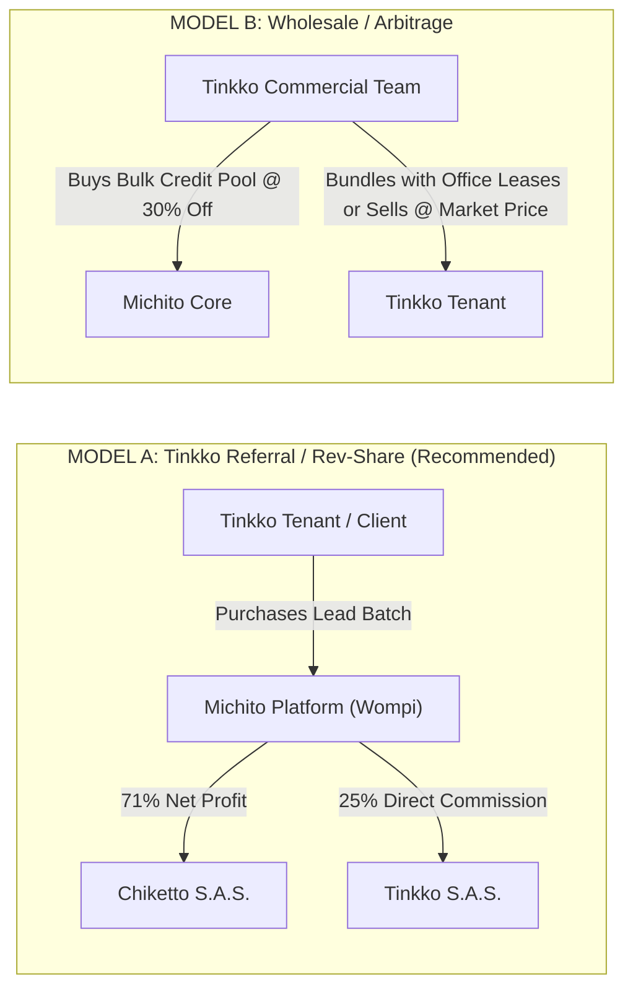

# 📊 Michito (導人) — Financial Model, Unit Economics & Volume Pricing Strategy 🇨🇴
## The Comprehensive Profit-Cost Architecture for LatAm B2B Lead Intelligence
*Version 2.0 • Chiketto Technologies S.A.S. • November 2026*

---

## 📑 Table of Contents
1. [Executive Summary & Commercial Philosophy](#1-executive-summary--commercial-philosophy)
2. [Updated Platform Cost Structure (Google Cloud Platform, Gateways, AI)](#2-updated-platform-cost-structure-google-cloud-platform-gateways-ai)
   - [2.1 Real GCP Infrastructure Run-Rate (Cloud SQL + Serverless Cloud Run)](#21-real-gcp-infrastructure-run-rate-cloud-sql--serverless-cloud-run)
   - [2.2 Payment Gateway Economics (Wompi Colombia)](#22-payment-gateway-economics-wompi-colombia)
   - [2.3 Data Extraction, Gemini AI & Socket SMTP Verification Costs](#23-data-extraction-gemini-ai--socket-smtp-verification-costs)
   - [2.4 Reseller / Referral Commissions (Tinkko & Channel Partners)](#24-reseller--referral-commissions-tinkko--channel-partners)
3. [Zero-Sales Reality & Sensitivity Scenarios](#3-zero-sales-reality--sensitivity-scenarios)
   - [3.1 The "Zero-Sales" Reality (Downside Protection & Monthly Burn)](#31-the-zero-sales-reality-downside-protection--monthly-burn)
   - [3.2 Dynamic Growth & Profitability Scenarios (0 to 100 Orders/Month)](#32-dynamic-growth--profitability-scenarios-0-to-100-ordersmonth)
4. [Volume Discount Curves & Batch Packages](#4-volume-discount-curves--batch-packages)
5. [Detailed Unit Economics Matrices (Tiers 1, 2, and 3)](#5-detailed-unit-economics-matrices-tiers-1-2-and-3)
   - [5.1 Tier 1: Direct Corporate Leads (Base Directory)](#51-tier-1-direct-corporate-leads-base-directory)
   - [5.2 Tier 2: Verified Decision-Maker Leads (Direct Inboxes)](#52-tier-2-verified-decision-maker-leads-direct-inboxes)
   - [5.3 Tier 3: Underwritten Corporate Leads (EBITDA + Judicial Audit)](#53-tier-3-underwritten-corporate-leads-ebitda--judicial-audit)
6. [Tinkko Commercial Partnership Models](#6-tinkko-commercial-partnership-models)
7. [Competitive Price & Value Comparison](#7-competitive-price--value-comparison)

---

## 1. Executive Summary & Commercial Philosophy

Legacy prospecting databases (Apollo.io, ZoomInfo, Lusha) enforce rigid, recurring monthly subscriptions in USD (\$99 to \$400 USD/month). In Colombia and Latin America, this model suffers from severe customer friction:
1. **Subscription Fatigue**: Colombian SMBs and agencies dread recurring USD charges on corporate credit cards due to FX volatility, 4x1000 taxes, and retention lock-in.
2. **High Waste Rate**: Sales teams buy a 1,000-credit monthly subscription, use 120 credits, and the remaining 880 expire unused.
3. **Local Quality Collapse**: Global crawlers have a 25%–30% error rate in Colombia because LinkedIn profiles are rarely updated.

### The Michito Model: Volume-Tiered "Pay-As-You-Go"
Michito sells **verified batches on demand in Colombian Pesos (COP)** via **Nequi, PSE, and Bancolombia** (and USD in Ecuador 🇪🇨 and DOP in Dominican Republic 🇩🇴).
* **Zero Commitments**: Pay only for what you need when you launch a campaign.
* **Volume Scalability**: The more leads a company buys in a single batch, the lower their effective unit cost.
* **Ultra-Low Fixed Cost Structure**: By implementing Google Cloud SQL (`db-f1-micro`, Enterprise Edition) paired with scale-to-zero Cloud Run containers, Michito operates on a baseline fixed run-rate of **~$10.00 USD / month (~$42.000 COP / month)**, making it virtually immune to prolonged dry periods.

---

## 2. Updated Platform Cost Structure (Google Cloud Platform, Gateways, AI)

```
┌────────────────────────────────────────────────────────────────────────────────────────┐
│                          MICHITO COST DRIVER BREAKDOWN                                 │
├───────────────────────────────┬───────────────────────────────┬────────────────────────┤
│ 1. FIXED PLATFORM COSTS       │ 2. VARIABLE GATEWAY (Wompi)   │ 3. PARTNER COMMISSIONS │
│ • Cloud SQL (db-f1-micro)     │ • Credit/Debit: 2.85% + $900  │ • Tinkko Rev-Share: 25%│
│ • Cloud Run (0-scale server)  │ • PSE / Nequi / Bancolombia   │ • Retained Net Margin: │
│ • Cloud Storage & Artifacts   │ • Effective: ~2.9% + IVA      │   70% – 71%            │
│ ~ $10 USD / mo ($42.000 COP)  │ Deducted per transaction      │ Deducted on referral   │
└───────────────────────────────┴───────────────────────────────┴────────────────────────┘
```

### 2.1 Real GCP Infrastructure Run-Rate (Cloud SQL + Serverless Cloud Run)
Michito runs on a hybrid serverless architecture in Google Cloud Platform (`us-central1`), optimized to balance instant response times against minimal fixed burn:

| GCP Component | Technical Specification | Active Fixed Cost (USD) | Active Fixed Cost (COP) | Variable Component |
| :--- | :--- | :--- | :--- | :--- |
| **Cloud SQL PostgreSQL 16** | `db-f1-micro` Enterprise Edition (0.6 GB RAM, 1 vCPU shared, 10 GB SSD) | \$9.20 USD / mo | \$39.000 COP / mo | Fixed base; handles up to 50 concurrent transactions |
| **Cloud Run API (`michito-api`)** | Multi-stage Python 3.13-slim container, 1 vCPU, 1 GB RAM, min-instances=0, max=5 | \$0.00 USD (Free Tier) | \$0.00 COP | \$0.000024 / vCPU-sec beyond 2M requests/mo |
| **Cloud Run Web (`michito-web`)** | Multi-stage Nginx Alpine SPA, 1 vCPU, 256 MB RAM, min-instances=0, max=5 | \$0.00 USD (Free Tier) | \$0.00 COP | \$0.000006 / vCPU-sec beyond 2M requests/mo |
| **Google Cloud Storage (GCS)** | `gs://michito-staging-deliverables` (standard regional storage) | \$0.20 USD / mo | \$1.000 COP / mo | \$0.02 / GB beyond 5 GB free tier |
| **Google Cloud Pub/Sub** | `michito-orders-staging` push subscription | \$0.00 USD (Free Tier) | \$0.00 COP | First 10 GB/month free |
| **Google Secret Manager** | 7 active application secrets | \$0.06 USD / mo | \$300 COP / mo | First 6 secret versions are free |
| **Artifact Registry** | Container image storage (`michito-repo`) | \$0.50 USD / mo | \$2.000 COP / mo | \$0.10 / GB / month |
| **Total Real Fixed Baseline** | **Baseline infrastructure with zero traffic** | **~$10.00 USD / mo** | **~$42.000 COP / mo** | Scales linearly with order volume |

> [!NOTE]
> By adopting Option A (Cloud SQL `db-f1-micro`), database cold starts and webhook timeout errors are 100% eliminated while holding total fixed monthly infrastructure to **~$42.000 COP (~$10 USD)**.

---

### 2.2 Payment Gateway Economics (Wompi Colombia 🇨🇴)

In Colombia, commercial intelligence and software services sold by Chiketto Technologies S.A.S. (*Responsable de IVA*) are subject to **19% Impuesto sobre las Ventas (IVA)**.

#### Colombian B2B Invoicing Flow
1. **Price Presentation**: Standard B2B quoting displays **Subtotal (Antes de IVA) + IVA (19%) = Total Facturado**.
   $$\text{Total Facturado (Wompi Charge)} = \text{Subtotal} \times 1.19$$
2. **Payment Gateway Base (Wompi)**: Wompi processes the **Total Facturado**:
   $$\text{Wompi Fee} = (\text{Total Facturado} \times 2.9\%) + \$900\text{ COP} + \text{IVA on fixed fee (19\%)}$$
   $$\text{Wompi Fee} = (\text{Total Facturado} \times 0.029) + \$1.071\text{ COP}$$
3. **DIAN Tax Remittance**: The collected 19% IVA is held on the balance sheet as *IVA Generado* and remitted bimestralmente to the DIAN.
4. **Partner Commission Calculation (Tinkko)**: Tinkko's 25% commission is calculated on the **Subtotal (Base Imponible / Antes de IVA)**, because IVA is a statutory government pass-through.

---

### 2.3 Data Extraction, Gemini AI & Socket SMTP Verification Costs

* **Statutory Open Data Registries (SODA / datos.gov.co)**: Supersociedades, RUES, SECOP I/II $\rightarrow$ **\$0 COP**.
* **Direct Socket SMTP Port 25 Ping**: Proprietary asynchronous TCP mailbox handshake $\rightarrow$ **\$0 COP**.
* **Google Gemini API (Gemini 1.5/2.0 Flash)**: Natural language brief parsing, intent profiling, and 5-touch email copy generation:
  - Input tokens: ~1,500 tokens / order ($\approx \$0.00015\text{ USD} \approx \$0.60\text{ COP}$).
  - Output tokens: ~1,000 tokens / order ($\approx \$0.00040\text{ USD} \approx \$1.60\text{ COP}$).
  - Total AI compute per 10-lead order: **~$2.20 COP**.
* **Buffer for Fallback Edge Verification (DNS + SERP proxy when needed)**:
  - **Tier 1 Lead**: \$50 COP per lead.
  - **Tier 2 Lead**: \$150 COP per lead.
  - **Tier 3 Lead**: \$350 COP per lead (accounting for judicial docket lookup queries).

---

### 2.4 Reseller / Referral Commissions (Tinkko & Channel Partners)
* **Standard Referral Commission**: **25.0%** of Subtotal (antes de IVA) paid to Tinkko for tenant orders.
* **Tinkko Value**: Zero operational overhead; pure profit on existing tenant foot-traffic.

---

## 3. Zero-Sales Reality & Sensitivity Scenarios

### 3.1 The "Zero-Sales" Reality (Downside Protection & Monthly Burn)

In an early-stage startup, zero-sales months can happen during launch phases, marketing pivots, or slow holiday periods (e.g., late December / January in Colombia).

```
┌────────────────────────────────────────────────────────────────────────────────────────┐
│                        MONTHLY FIXED BURN AT ZERO SALES                                │
├────────────────────────────────────────┬───────────────────────────────────────────────┤
│ Cloud SQL PostgreSQL 16 (db-f1-micro)  │ $39.000 COP (~$9.20 USD)                      │
│ Cloud Run API & Web Containers         │ $0 COP (Scales to 0 instances when idle)      │
│ Google Cloud Storage (GCS)             │ $1.000 COP (~$0.20 USD)                       │
│ Artifact Registry & Secrets            │ $2.000 COP (~$0.50 USD)                       │
│ Wompi Gateway Fee                      │ $0 COP (Purely variable, per transaction)     │
│ Tinkko Referral Commission             │ $0 COP (Zero sales = Zero commission)         │
├────────────────────────────────────────┼───────────────────────────────────────────────┤
│ TOTAL MONTHLY RUN-RATE AT 0 SALES      │ $42.000 COP / month (~$10.00 USD / month)     │
│ ANNUAL "ZOMBIE" CARRYING COST          │ $504.000 COP / year (~$120.00 USD / year)     │
└────────────────────────────────────────┴───────────────────────────────────────────────┘
```

> [!TIP]
> **Survival Advantage**: Because Cloud Run and Pub/Sub scale to zero, Michito can survive for an entire year with zero sales on a total capital outlay of just **\$504.000 COP (~$120 USD)**.

---

### 3.2 Dynamic Growth & Profitability Scenarios (0 to 100 Orders/Month)

Assumes a realistic blended sales mix across Tier 1 (15%), Tier 2 (70%), and Tier 3 (15%), with 65% generated via Tinkko partners (25% commission) and 35% sold directly (0% commission).

| Scenario | Monthly Orders | Total Leads | Gross Subtotal (Antes IVA) | Wompi Fees | Partner Comm. (Tinkko) | Fixed GCP Run-Rate | Variable Data & AI | Net Operating Profit (COP) | Net Operating Margin |
| :--- | :---: | :---: | :---: | :---: | :---: | :---: | :---: | :---: | :---: |
| **0. Zero Sales** | **0** | **0** | **\$0** | \$0 | \$0 | \$42.000 | \$0 | **-\$42.000 COP** | *N/A* |
| **1. First Sale (Breakeven)** | **1 order (10 T2)** | **10** | **\$300.000** | \$11.424 | \$48.750 | \$42.000 | \$1.500 | **+\$196.326 COP** | **65.4%** |
| **2. Minimal Pilot** | **5 orders** | **120** | **\$3.200.000** | \$111.400 | \$520.000 | \$42.000 | \$18.000 | **+\$2.508.600 COP** | **78.4%** |
| **3. Early Traction (Hebi + Tinkko)**| **15 orders** | **450** | **\$11.800.000** | \$410.600 | \$1.917.500 | \$45.000 | \$67.500 | **+\$9.359.400 COP** | **79.3%** |
| **4. Growth Blitz** | **40 orders** | **1,500** | **\$38.500.000** | \$1.339.800 | \$6.256.250 | \$55.000 | \$225.000 | **+\$30.623.950 COP** | **79.5%** |
| **5. Scaled Ecosystem** | **100 orders** | **4,500** | **\$112.000.000** | \$3.897.600 | \$18.200.000 | \$85.000 | \$675.000 | **+\$89.142.400 COP** | **79.6%** |

---

## 4. Volume Discount Curves & Batch Packages

Clients buying in bulk receive progressive, automatic unit price discounts on the Subtotal:

| Batch Size | Segment Name | Volume Discount | Target Buyer Profile | Typical Use Case |
| :---: | :---: | :---: | :--- | :--- |
| **10 leads** | **Starter / Pilot** | **0% (List Price)** | Solopreneurs, Tinkko internal pilot, agency tests | Fast POC or highly niche targeting |
| **50 leads** | **Growth** | **12% Discount** | Seed startups, boutique consultancies | 1-month focused SDR outbound campaign |
| **100 leads** | **Expansion** | **20% Discount** | Mid-market B2B, legal firms, logistics | Multi-city commercial blitz |
| **250 leads** | **Scale** | **28% Discount** | Growth companies, enterprise office leasing | Quarterly regional sales team pipeline |
| **500 leads** | **Enterprise** | **35% Discount** | Large service providers, financial institutions | Multi-rep annual outbound engine |
| **1,000 leads** | **Corporate / Wholesale** | **42% Discount** | B2B marketing agencies, white-label resellers | Bulk cold calling & multi-touch sequences |

---

## 5. Detailed Unit Economics Matrices (Tiers 1, 2, and 3)

### 5.1 Tier 1: Direct Corporate Leads (Base Directory)
*Includes: NIT, Razón Social, Sector CIIU, Ciudad, Ingresos Auditados, Dirección, Sitio Web, Teléfono Fijo, Google X-Ray Search.*  
*Base Retail Price: **\$5.000 COP / lead (Antes de IVA)***

| Qty | Disc. | Unit Subtotal | Subtotal (Antes IVA) | IVA (19%) | Total Facturado (Wompi) | Wompi Fee | Tinkko Comm. (25%) | GCP & Data Cost | Direct Net Profit (Margin) | Partner Net Profit (Margin) |
| :---: | :---: | :---: | :---: | :---: | :---: | :---: | :---: | :---: | :---: | :---: |
| **10** | 0% | \$5.000 | **\$50.000** | \$9.500 | **\$59.500** | \$2.796 | \$12.500 | \$500 | **\$46.704 (93.4%)** | **\$34.204 (68.4%)** |
| **50** | 12% | \$4.400 | **\$220.000** | \$41.800 | **\$261.800** | \$8.663 | \$55.000 | \$2.500 | **\$208.837 (94.9%)** | **\$153.837 (69.9%)** |
| **100** | 20% | \$4.000 | **\$400.000** | \$76.000 | **\$476.000** | \$14.875 | \$100.000 | \$5.000 | **\$380.125 (95.0%)** | **\$280.125 (70.0%)** |
| **250** | 28% | \$3.600 | **\$900.000** | \$171.000 | **\$1.071.000** | \$32.130 | \$225.000 | \$12.500 | **\$855.370 (95.0%)** | **\$630.370 (70.0%)** |
| **500** | 35% | \$3.250 | **\$1.625.000** | \$308.750 | **\$1.933.750** | \$57.149 | \$406.250 | \$25.000 | **\$1.542.851 (94.9%)** | **\$1.136.601 (69.9%)** |
| **1,000** | 42% | \$2.900 | **\$2.900.000** | \$551.000 | **\$3.451.000** | \$101.150 | \$725.000 | \$50.000 | **\$2.748.850 (94.8%)** | **\$2.023.850 (69.8%)** |

---

### 5.2 Tier 2: Verified Decision-Maker Leads (Direct Inboxes)
*Includes: Everything in Tier 1 + Nombre del Tomador de Decisión, Cargo Oficial, **Correo Corporativo 0-Rebotes (Socket SMTP)**, Celular Directo / SECOP, Perfil de LinkedIn.*  
*Base Retail Price: **\$30.000 COP / lead (Antes de IVA)***

| Qty | Disc. | Unit Subtotal | Subtotal (Antes IVA) | IVA (19%) | Total Facturado (Wompi) | Wompi Fee | Tinkko Comm. (25%) | GCP & Data Cost | Direct Net Profit (Margin) | Partner Net Profit (Margin) |
| :---: | :---: | :---: | :---: | :---: | :---: | :---: | :---: | :---: | :---: | :---: |
| **10** | 0% | \$30.000 | **\$300.000** | \$57.000 | **\$357.000** | \$11.424 | \$75.000 | \$1.500 | **\$287.076 (95.7%)** | **\$212.076 (70.7%)** |
| **50** | 12% | \$26.400 | **\$1.320.000** | \$250.800 | **\$1.570.800** | \$46.624 | \$330.000 | \$7.500 | **\$1.265.876 (95.9%)** | **\$935.876 (70.9%)** |
| **100** | 20% | \$24.000 | **\$2.400.000** | \$456.000 | **\$2.856.000** | \$83.895 | \$600.000 | \$15.000 | **\$2.301.105 (95.9%)** | **\$1.701.105 (70.9%)** |
| **250** | 28% | \$21.600 | **\$5.400.000** | \$1.026.000 | **\$6.426.000** | \$187.425 | \$1.350.000 | \$37.500 | **\$5.175.075 (95.8%)** | **\$3.825.075 (70.8%)** |
| **500** | 35% | \$19.500 | **\$9.750.000** | \$1.852.500 | **\$11.602.500** | \$337.543 | \$2.437.500 | \$75.000 | **\$9.337.457 (95.8%)** | **\$6.899.957 (70.8%)** |
| **1,000** | 42% | \$17.400 | **\$17.400.000** | \$3.306.000 | **\$20.706.000** | \$601.545 | \$4.350.000 | \$150.000 | **\$16.648.455 (95.7%)** | **\$12.298.455 (70.7%)** |

---

### 5.3 Tier 3: Underwritten Corporate Leads (EBITDA + Judicial Audit)
*Includes: Everything in Tier 2 + **Cálculo de EBITDA y Margen Operativo NIIF**, Historial de Crecimiento, **Auditoría de Demandas Rama Judicial (0 procesos de cobro)**, Paz y Salvo Contraloría BDME.*  
*Base Retail Price: **\$65.000 COP / lead (Antes de IVA)***

| Qty | Disc. | Unit Subtotal | Subtotal (Antes IVA) | IVA (19%) | Total Facturado (Wompi) | Wompi Fee | Tinkko Comm. (25%) | GCP & Data Cost | Direct Net Profit (Margin) | Partner Net Profit (Margin) |
| :---: | :---: | :---: | :---: | :---: | :---: | :---: | :---: | :---: | :---: | :---: |
| **10** | 0% | \$65.000 | **\$650.000** | \$123.500 | **\$773.500** | \$23.502 | \$162.500 | \$3.500 | **\$622.998 (95.8%)** | **\$460.498 (70.8%)** |
| **50** | 12% | \$57.200 | **\$2.860.000** | \$543.400 | **\$3.403.400** | \$99.769 | \$715.000 | \$17.500 | **\$2.742.731 (95.9%)** | **\$2.027.731 (70.9%)** |
| **100** | 20% | \$52.000 | **\$5.200.000** | \$988.000 | **\$6.188.000** | \$180.523 | \$1.300.000 | \$35.000 | **\$4.984.477 (95.9%)** | **\$3.684.477 (70.9%)** |
| **250** | 28% | \$46.800 | **\$11.700.000** | \$2.223.000 | **\$13.923.000** | \$404.838 | \$2.925.000 | \$87.500 | **\$11.207.662 (95.8%)** | **\$8.282.662 (70.8%)** |
| **500** | 35% | \$42.250 | **\$21.125.000** | \$4.013.750 | **\$25.138.750** | \$730.094 | \$5.281.250 | \$175.000 | **\$20.219.906 (95.7%)** | **\$14.938.656 (70.7%)** |
| **1,000** | 42% | \$37.700 | **\$37.700.000** | \$7.163.000 | **\$44.863.000** | \$1.302.098 | \$9.425.000 | \$350.000 | **\$36.047.902 (95.6%)** | **\$26.622.902 (70.6%)** |

---

## 6. Tinkko Commercial Partnership Models



### 6.1 Model A: Revenue Share Referral (25% Commission) — Recommended
* Tinkko features Michito in tenant portals and community newsletters with `partner=tinkko`.
* Wompi processes the payment. Michito automatically calculates and disburses Tinkko's **25% cut** monthly.
* A single tenant purchasing a 100-lead Tier 2 batch generates **\$600.000 COP pure commission** for Tinkko. Ten tenants buying per month = **\$6.000.000 COP/mo passive income** for Tinkko.

### 6.2 Model B: Wholesale Volume Arbitrage
* Tinkko purchases a bulk monthly pool of 2,500 credits at wholesale (\$15.000 COP/Tier 2 lead).
* Tinkko bundles leads into their enterprise office leases, retaining 100% of the markup.

---

## 7. Competitive Price & Value Comparison

| Criteria | Global Databases (Apollo.io / ZoomInfo) | Cámara de Comercio (RUES / Confecámaras) | Michito (導人) 🇨🇴 |
| :--- | :--- | :--- | :--- |
| **Payment Model** | Monthly USD recurring subscription (\$99–\$350 USD/mo). | One-off static CD/Excel purchase (\$2.000.000–\$5.000.000 COP). | **Pay-As-You-Go Batches in COP (No subscription).** |
| **Pricing per Lead** | \$0.10–\$0.20 USD (\$400–\$850 COP) with high waste. | \$500–\$1.000 COP (Bulk only, min 3,000 records). | **\$2.900 to \$30.000 COP depending on tier & volume.** |
| **Colombia Accuracy** | 25%–30% bounce rate; obsolete LinkedIn roles. | 0% verified inboxes (generic `info@`, `contacto@`). | **100% verified via direct TCP Port 25 Socket Handshake (0 bounces).** |
| **Financial Health (EBITDA)** | ❌ No audited IFRS statements. | ❌ Only basic equity/capital stated at registration. | **✅ Computed audited EBITDA, Operating Margin & 3-year revenue trend.** |
| **Judicial Risk Screening** | ❌ None. | ❌ None. | **✅ Rama Judicial civil debt lawsuit & Contraloría fiscal clearance.** |
| **Direct Phones / Cell** | ❌ Disconnected PBX switchboards. | ❌ Legal domicile landlines only. | **✅ SECOP II verified corporate officer mobile contacts.** |

---
*Authored by Chiketto Technologies S.A.S. • Strategic Financial Intelligence Unit*
