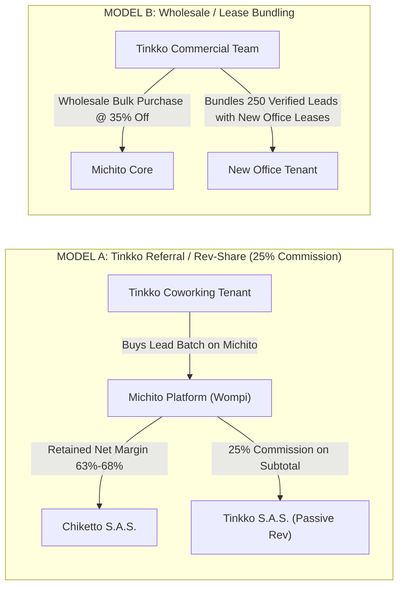

# 📊 Michito (導人) — Financial Model, Unit Economics & Pricing Recalibration Strategy 🇨🇴
## Multi-Environment GCP Run-Rate, AI Economics, Founder Runway, and Competitive Scenarios
*Version 3.0 • Chiketto Technologies S.A.S. • November 2026*

---

## 📑 Table of Contents
1. [Executive Summary & Commercial Philosophy](#1-executive-summary--commercial-philosophy)
2. [Multi-Environment Platform Cost Structure (GCP, Gateways, AI & Human Capital)](#2-multi-environment-platform-cost-structure-gcp-gateways-ai--human-capital)
   - [2.1 Multi-Environment Infrastructure Run-Rate (Staging + Production)](#21-multi-environment-infrastructure-run-rate-staging--production)
   - [2.2 AI Agent Token Economics & Rate Limiting (Gemini 1.5/2.0 Flash)](#22-ai-agent-token-economics--rate-limiting-gemini-1520-flash)
   - [2.3 Payment Gateway Friction & Invoicing Flow (Wompi Colombia 🇨🇴)](#23-payment-gateway-friction--invoicing-flow-wompi-colombia)
   - [2.4 Operational Runway & Human Capital (Founder Compensation & Future Team Reserve)](#24-operational-runway--human-capital-founder-compensation--future-team-reserve)
3. [Zero-Sales Reality & Downside Protection](#3-zero-sales-reality--downside-protection)
4. [Strategic Pricing Recalibration: Scenario A vs. Scenario B](#4-strategic-pricing-recalibration-scenario-a-vs-scenario-b)
   - [4.1 The Strategic Problem: Customer Resistance vs. Market Reality](#41-the-strategic-problem-customer-resistance-vs-market-reality)
   - [4.2 Scenario A: Aggressive Volume (Apollo-Competitive) Matrix](#42-scenario-a-aggressive-volume-apollo-competitive-matrix)
   - [4.3 Scenario B: Balanced Value Pack (Founder Runway) Matrix](#43-scenario-b-balanced-value-pack-founder-runway-matrix)
   - [4.4 Minimum Order Floor & Packaging Policy](#44-minimum-order-floor--packaging-policy)
5. [Side-by-Side Breakeven & Runway Sensitivity Analysis](#5-side-by-side-breakeven--runway-sensitivity-analysis)
   - [5.1 Breakeven Matrix (Covering Real Infrastructure Overhead)](#51-breakeven-matrix-covering-real-infrastructure-overhead)
   - [5.2 Target Runway Matrix ($11,400,000 COP / ~$2,850 USD Monthly Net Target)](#52-target-runway-matrix-11400000-cop--2850-usd-monthly-net-target)
6. [Tinkko Commercial Partnership Models](#6-tinkko-commercial-partnership-models)
7. [Competitive Objection Handling Playbook: Michito vs. Apollo.io in LatAm](#7-competitive-objection-handling-playbook-michito-vs-apolloio-in-latam)

---

## 1. Executive Summary & Commercial Philosophy

Prospecting tools like Apollo.io, ZoomInfo, and Lusha enforce recurring monthly subscriptions in USD (\$49 to \$350 USD/month). While global enterprise sales teams are accustomed to credit card SaaS billing, Latin American SMBs and regional sales agencies experience severe friction:
1. **Subscription Fatigue & FX Friction**: Colombian businesses dread foreign currency credit card deductions subject to 4x1000 taxes, fluctuating exchange rates, and complex corporate expense justification.
2. **Expired Credit Wastage**: Users purchasing 1,000 monthly credits frequently utilize fewer than 150 before expiration, resulting in an effective real acquisition cost that is 5x to 8x higher than advertised.
3. **Severe Local Data Decay**: Global crawlers exhibit a 25%–35% bounce and inaccuracy rate in Colombia 🇨🇴, Dominican Republic 🇩🇴, and Ecuador 🇪🇨 due to unmaintained LinkedIn profiles and outdated scraper caches.

### The Michito Model: On-Demand Verified Batches with Statutory Backing
Michito delivers **statutory-verified B2B leads on demand** paid via **Bancolombia, PSE, Nequi, and Credit Cards** (COP in Colombia 🇨🇴, DOP in Dominican Republic 🇩🇴, and USD in Ecuador 🇪🇨).
* **Zero Commitments**: Pay strictly for what you need when launching an outbound sequence.
* **Never Sell Non-Existent Data**: If verified contacts cannot be confirmed via statutory registries or direct socket handshakes, they are excluded from the billable order.
* **Volume Scalability**: Transparent tiered volume discounts allow competitive cost-per-lead parity with global tools while delivering 100% deliverable data.

---

## 2. Multi-Environment Platform Cost Structure (GCP, Gateways, AI & Human Capital)

```
┌────────────────────────────────────────────────────────────────────────────────────────┐
│                        MICHITO FULL OPERATIONAL COST DRIVERS                           │
├───────────────────────────────┬───────────────────────────────┬────────────────────────┤
│ 1. MULTI-ENV GCP RUN-RATE     │ 2. VARIABLE GATEWAY (Wompi)   │ 3. HUMAN RUNWAY TARGET │
│ • Cloud SQL (Staging + Prod)  │ • Effective: 2.9% + $1,071 COP│ • Founder Salary: $10M │
│ • Cloud Run (4 Containers)    │   deducted per transaction    │ • Team Buffer: $1M     │
│ • GCS, Secrets, Domain, SMTP  │ • Requires $25,000 COP min    │ • Target Runway:       │
│ ~ $400.000 COP / mo (~$100 USD│   order floor to curb fee drag│   $11,400,000 COP / mo │
└───────────────────────────────┴───────────────────────────────┴────────────────────────┘
```

### 2.1 Multi-Environment Infrastructure Run-Rate (Staging + Production)
Michito maintains two isolated environments in Google Cloud Platform (`us-central1`): **Staging** (for pre-production integration and verification) and **Production** (for customer-facing workloads):

| Component | Technical Specification | Staging Cost (USD) | Prod Cost (USD) | Total Fixed (USD) | Total Fixed (COP) | Variable Component |
| :--- | :--- | :---: | :---: | :---: | :---: | :--- |
| **Cloud SQL PostgreSQL 16** | `db-f1-micro` Enterprise Edition (0.6 GB RAM, 1 vCPU shared, 10 GB SSD) | \$9.20 | \$25.00 – \$45.00 | ~\$35.00 – \$55.00 | ~\$140.000 – \$220.000 | Baseline storage & connection pooling |
| **Cloud Run Services** | 4 multi-stage containers (`api-staging`, `web-staging`, `api-prod`, `web-prod`), min=0 | \$0.00 (Free Tier) | \$5.00 – \$15.00 | ~\$10.00 | ~\$40.000 | Scale-to-zero when idle; \$0.000024/vCPU-s beyond 2M req |
| **Google Cloud Storage (GCS)** | `gs://michito-staging-deliverables` & `gs://michito-prod-deliverables` | \$0.20 | \$2.00 | ~\$2.50 | ~\$10.000 | \$0.02 / GB beyond 5 GB free tier |
| **Artifact Registry & CI/CD** | Container registry + Cloud Build triggers | \$0.50 | \$4.50 | ~\$5.00 | ~\$20.000 | Container image storage |
| **Secret Manager & Logging** | Production & staging application secrets | \$0.06 | \$2.00 | ~\$2.50 | ~\$10.000 | Free tier covers first 6 secrets |
| **Google Workspace & Domain** | `info@chiketto.co` SMTP relay, DNS, SSL certs | — | \$12.00 | ~\$12.00 | ~\$48.000 | Fixed Google Workspace business seat |
| **Total Carrying Baseline** | **Full dual-environment monthly infrastructure** | **~$10.00 USD** | **~$70.00 – \$90.00 USD** | **~$80.00 – \$100.00 USD** | **~$350.000 – \$400.000 COP** | Stable baseline even during zero-sales months |

---

### 2.2 AI Agent Token Economics & Rate Limiting (Gemini 1.5/2.0 Flash)

Michito utilizes Google Gemini Flash for natural language brief interpretation, ICP profiling, and personalized 5-touch email copy generation.

#### Token Consumption Profile
* **Intent Profiler (Step 1 Discovery)**:
  - Input: System prompt + User query + Industry taxonomies (~1,200 tokens) $\approx \$0.00012\text{ USD}$ (~$0.48 COP).
  - Output: Structured JSON filter specification (~250 tokens) $\approx \$0.00010\text{ USD}$ (~$0.40 COP).
  - Subtotal Intent: **~$0.88 COP per query**.
* **5-Touch Outreach Copywriter (Post-Payment Delivery)**:
  - Input: Lead profile + Company dossier + Value proposition (~1,000 tokens) $\approx \$0.00010\text{ USD}$ (~$0.40 COP).
  - Output: 5 personalized email templates (~800 tokens) $\approx \$0.00032\text{ USD}$ (~$1.28 COP).
  - Subtotal Copywriting: **~$1.68 COP per lead batch**.
* **Total AI Cost per Delivered Order**: **~$2.50 to $3.00 COP per order**.

#### Caching & Rate-Limiting Guardrails
1. **Query-Level Redis/SQL Caching**: Duplicate intent queries (e.g., repeated searches for "Coworking in Santo Domingo") hit the local database cache, resulting in **$0 COP AI cost**.
2. **Rate Limiting**: Intent generation is limited to 5 unauthenticated searches per IP per hour to prevent token exhaustion.
3. **Batch Generation**: Lead dossiers generate outreach copy in a single consolidated prompt rather than serial individual calls, minimizing input token overhead by 70%.

---

### 2.3 Payment Gateway Friction & Invoicing Flow (Wompi Colombia 🇨🇴)

Commercial intelligence software delivered by Chiketto Technologies S.A.S. is subject to **19% Impuesto sobre las Ventas (IVA)** in Colombia:

1. **Transaction Calculation**:
   $$\text{Total Facturado (Wompi Charge)} = \text{Subtotal (Antes de IVA)} \times 1.19$$
2. **Wompi Gateway Cost Structure**:
   $$\text{Wompi Fee} = (\text{Total Facturado} \times 2.9\%) + \$900\text{ COP} + \text{IVA on fixed fee (19\%)}$$
   $$\text{Wompi Fee} = (\text{Total Facturado} \times 0.029) + \$1.071\text{ COP}$$
3. **Gateway Drag on Micro-Transactions**:
   - On an **$8,000 COP order** (10 Tier 1 leads at $800 COP), Wompi consumes **$1,347 COP (16.8% of the gross sale)**.
   - On a **$25,000 COP order**, Wompi fee is **$1,934 COP (7.7% of the gross sale)**.
   - On a **$250,000 COP order**, Wompi fee is **$9,698 COP (3.9% of the gross sale)**.

> [!IMPORTANT]
> To eliminate gateway fee erosion, Michito must enforce a **Minimum Order Floor of $25,000 COP** across all lead packages.

---

### 2.4 Operational Runway & Human Capital (Founder Compensation & Future Team Reserve)

Currently, the founder operates Michito as a sole developer/operator taking **$0 COP in salary**. To build a resilient, venture-viable or profitable bootstrapped operation, the economic model targets the following sustainable monthly human capital runway:

* **Founder Compensation Target**: **$10,000,000 COP / month (~$2,500 USD / month)**.
* **Future Team / Maintenance Buffer**: **$1,000,000 COP / month (~$250 USD / month)** (freelance support, QA, edge proxy reserves).
* **Total Target Monthly Runway**: **$11,400,000 COP / month (~$2,850 USD / month)** (Infra: $400,000 COP + Team: $1,000,000 COP + Founder: $10,000,000 COP).

---

## 3. Zero-Sales Reality & Downside Protection

In prolonged low-volume or zero-sales periods, Michito's serverless containers scale down to zero active instances:

```
┌────────────────────────────────────────────────────────────────────────────────────────┐
│                        MONTHLY FIXED BURN AT ZERO SALES                                │
├────────────────────────────────────────┬───────────────────────────────────────────────┤
│ Cloud SQL Staging (db-f1-micro)        │ $36.800 COP (~$9.20 USD)                      │
│ Cloud SQL Production (db-f1-micro)     │ $140.000 COP (~$35.00 USD)                    │
│ Cloud Run API & Web (4 containers)     │ $0 COP (Scales to 0 instances when idle)      │
│ Google Cloud Storage & Artifacts       │ $20.000 COP (~$5.00 USD)                      │
│ Google Workspace Domain & SMTP Relay   │ $48.000 COP (~$12.00 USD)                     │
│ Secret Manager & Logging               │ $10.000 COP (~$2.50 USD)                      │
│ Wompi Gateway Fee                      │ $0 COP (Purely variable, per transaction)     │
│ Tinkko Referral Commission             │ $0 COP (Zero sales = Zero commission)         │
├────────────────────────────────────────┼───────────────────────────────────────────────┤
│ TOTAL HARD INFRASTRUCTURE BURN         │ $254.800 – $400.000 COP / mo (~$65 – $100 USD)│
│ ANNUAL SURVIVAL CARRYING COST          │ $3.000.000 – $4.800.000 COP (~$750 – $1,200)  │
└────────────────────────────────────────┴───────────────────────────────────────────────┘
```

> [!TIP]
> Even with dedicated staging and production database instances, Michito can survive a complete 12-month commercial winter on less than **$1,000 USD** in total capital outlay.

---

## 4. Strategic Pricing Recalibration: Scenario A vs. Scenario B

### 4.1 The Strategic Problem: Customer Resistance vs. Market Reality

Customer feedback indicates that Michito's previous base price (**$30,000 COP / ~$7.50 USD** per Tier 2 lead) created significant friction when prospects compared it to Apollo.io's perceived unit cost ($0.10–$0.20 USD).

However, comparing raw unverified scraped data with 100% verified, statutory-backed dossiers requires careful framing:
* If prices are dropped to **Scenario A** ($800 / $2,500 / $6,000 COP), Michito completely eliminates price resistance, matching Apollo on volume while retaining a **86%–90% direct gross margin**.
* If prices adopt **Scenario B** ($1,500 / $6,200 / $15,000 COP), Michito positions as a premium high-touch dossier provider, requiring **60% fewer orders** to fund the founder runway.

---

### 4.2 Scenario A: Aggressive Volume (Apollo-Competitive) Matrix

Designed to maximize market penetration, encourage self-service swipe purchases, and directly neutralize Apollo objections:
* **Tier 1 (Base Directory)**: **$800 COP (~$0.20 USD)**
* **Tier 2 (Verified Inboxes)**: **$2,500 COP (~$0.60 USD)**
* **Tier 3 (Underwritten Corporate)**: **$6,000 COP (~$1.50 USD)**

#### Tier 1: Base Directory ($800 COP Base)
| Batch Qty | Disc. | Unit Price | Subtotal (Antes IVA) | Wompi Fee | Variable Cost | Direct Net Profit (Margin) | Partner Net Profit (Margin) |
| :---: | :---: | :---: | :---: | :---: | :---: | :---: | :---: |
| **10** | 0% | $800 COP | $8,000 COP | $1,347 COP | $502 COP | $6,151 COP (76.9%) | $4,151 COP (51.9%) |
| **25** | 5% | $760 COP | $19,000 COP | $1,727 COP | $1,252 COP | $16,021 COP (84.3%) | $11,271 COP (59.3%) |
| **50** | 10% | $720 COP | $36,000 COP | $2,313 COP | $2,502 COP | $31,184 COP (86.6%) | $22,184 COP (61.6%) |
| **100** | 18% | $656 COP | $65,600 COP | $3,335 COP | $5,002 COP | $57,263 COP (87.3%) | $40,863 COP (62.3%) |
| **250** | 25% | $600 COP | $150,000 COP | $6,248 COP | $12,502 COP | $131,250 COP (87.5%) | $93,750 COP (62.5%) |
| **500** | 32% | $544 COP | $272,000 COP | $10,458 COP | $25,002 COP | $236,540 COP (87.0%) | $168,540 COP (62.0%) |
| **1,000**| 40% | $480 COP | $480,000 COP | $17,636 COP | $50,002 COP | $412,362 COP (85.9%) | $292,362 COP (60.9%) |

#### Tier 2: Verified Decision-Makers ($2,500 COP Base)
| Batch Qty | Disc. | Unit Price | Subtotal (Antes IVA) | Wompi Fee | Variable Cost | Direct Net Profit (Margin) | Partner Net Profit (Margin) |
| :---: | :---: | :---: | :---: | :---: | :---: | :---: | :---: |
| **10** | 0% | $2,500 COP | $25,000 COP | $1,934 COP | $1,502 COP | $21,564 COP (86.3%) | $15,314 COP (61.3%) |
| **25** | 5% | $2,375 COP | $59,375 COP | $3,120 COP | $3,752 COP | $52,503 COP (88.4%) | $37,659 COP (63.4%) |
| **50** | 10% | $2,250 COP | $112,500 COP | $4,953 COP | $7,502 COP | $100,044 COP (88.9%) | $71,919 COP (63.9%) |
| **100** | 18% | $2,050 COP | $205,000 COP | $8,146 COP | $15,002 COP | $181,852 COP (88.7%) | $130,602 COP (63.7%) |
| **250** | 25% | $1,875 COP | $468,750 COP | $17,248 COP | $37,502 COP | $414,000 COP (88.3%) | $296,813 COP (63.3%) |
| **500** | 32% | $1,700 COP | $850,000 COP | $30,404 COP | $75,002 COP | $744,593 COP (87.6%) | $532,093 COP (62.6%) |
| **1,000**| 40% | $1,500 COP | $1,500,000 COP | $52,836 COP | $150,002 COP | $1,297,162 COP (86.5%)| $922,162 COP (61.5%) |

#### Tier 3: Underwritten Corporate Leads ($6,000 COP Base)
| Batch Qty | Disc. | Unit Price | Subtotal (Antes IVA) | Wompi Fee | Variable Cost | Direct Net Profit (Margin) | Partner Net Profit (Margin) |
| :---: | :---: | :---: | :---: | :---: | :---: | :---: | :---: |
| **10** | 0% | $6,000 COP | $60,000 COP | $3,142 COP | $3,502 COP | $53,356 COP (88.9%) | $38,356 COP (63.9%) |
| **25** | 5% | $5,700 COP | $142,500 COP | $5,989 COP | $8,752 COP | $127,759 COP (89.7%) | $92,134 COP (64.7%) |
| **50** | 10% | $5,400 COP | $270,000 COP | $10,389 COP | $17,502 COP | $242,109 COP (89.7%) | $174,609 COP (64.7%) |
| **100** | 18% | $4,920 COP | $492,000 COP | $18,050 COP | $35,002 COP | $438,948 COP (89.2%) | $315,948 COP (64.2%) |
| **250** | 25% | $4,500 COP | $1,125,000 COP | $39,895 COP | $87,502 COP | $997,603 COP (88.7%) | $716,353 COP (63.7%) |
| **500** | 32% | $4,080 COP | $2,040,000 COP | $71,471 COP | $175,002 COP | $1,793,526 COP (87.9%)| $1,283,526 COP (62.9%)|
| **1,000**| 40% | $3,600 COP | $3,600,000 COP | $125,307 COP | $350,002 COP | $3,124,691 COP (86.8%)| $2,224,691 COP (61.8%)|

---

### 4.3 Scenario B: Balanced Value Pack (Founder Runway) Matrix

Positioned as an executive data underwriting boutique for higher-ticket B2B agencies and enterprise sales teams:
* **Tier 1 (Base Directory)**: **$1,500 COP (~$0.38 USD)**
* **Tier 2 (Verified Inboxes)**: **$6,200 COP (~$1.55 USD)**
* **Tier 3 (Underwritten Corporate)**: **$15,000 COP (~$3.75 USD)**

#### Tier 1: Base Directory ($1,500 COP Base)
| Batch Qty | Disc. | Unit Price | Subtotal (Antes IVA) | Wompi Fee | Variable Cost | Direct Net Profit (Margin) | Partner Net Profit (Margin) |
| :---: | :---: | :---: | :---: | :---: | :---: | :---: | :---: |
| **10** | 0% | $1,500 COP | $15,000 COP | $1,589 COP | $502 COP | $12,909 COP (86.1%) | $9,159 COP (61.1%) |
| **25** | 5% | $1,425 COP | $35,625 COP | $2,300 COP | $1,252 COP | $32,072 COP (90.0%) | $23,166 COP (65.0%) |
| **50** | 10% | $1,350 COP | $67,500 COP | $3,400 COP | $2,502 COP | $61,597 COP (91.3%) | $44,722 COP (66.3%) |
| **100** | 18% | $1,230 COP | $123,000 COP | $5,316 COP | $5,002 COP | $112,682 COP (91.6%) | $81,932 COP (66.6%) |
| **250** | 25% | $1,125 COP | $281,250 COP | $10,777 COP | $12,502 COP | $257,971 COP (91.7%) | $187,659 COP (66.7%) |
| **500** | 32% | $1,020 COP | $510,000 COP | $18,671 COP | $25,002 COP | $466,327 COP (91.4%) | $338,827 COP (66.4%) |
| **1,000**| 40% | $900 COP | $900,000 COP | $32,130 COP | $50,002 COP | $817,868 COP (90.9%) | $592,868 COP (65.9%) |

#### Tier 2: Verified Decision-Makers ($6,200 COP Base)
| Batch Qty | Disc. | Unit Price | Subtotal (Antes IVA) | Wompi Fee | Variable Cost | Direct Net Profit (Margin) | Partner Net Profit (Margin) |
| :---: | :---: | :---: | :---: | :---: | :---: | :---: | :---: |
| **10** | 0% | $6,200 COP | $62,000 COP | $3,211 COP | $1,502 COP | $57,287 COP (92.4%) | $41,787 COP (67.4%) |
| **25** | 5% | $5,890 COP | $147,250 COP | $6,153 COP | $3,752 COP | $137,345 COP (93.3%) | $100,533 COP (68.3%) |
| **50** | 10% | $5,580 COP | $279,000 COP | $10,699 COP | $7,502 COP | $260,799 COP (93.5%) | $191,049 COP (68.5%) |
| **100** | 18% | $5,084 COP | $508,400 COP | $18,616 COP | $15,002 COP | $474,782 COP (93.4%) | $347,682 COP (68.4%) |
| **250** | 25% | $4,650 COP | $1,162,500 COP | $41,189 COP | $37,502 COP | $1,083,809 COP (93.2%)| $793,184 COP (68.2%) |
| **500** | 32% | $4,216 COP | $2,108,000 COP | $73,818 COP | $75,002 COP | $1,959,180 COP (92.9%)| $1,432,180 COP (67.9%)|
| **1,000**| 40% | $3,720 COP | $3,720,000 COP | $129,448 COP | $150,002 COP | $3,440,550 COP (92.5%)| $2,510,550 COP (67.5%)|

#### Tier 3: Underwritten Corporate Leads ($15,000 COP Base)
| Batch Qty | Disc. | Unit Price | Subtotal (Antes IVA) | Wompi Fee | Variable Cost | Direct Net Profit (Margin) | Partner Net Profit (Margin) |
| :---: | :---: | :---: | :---: | :---: | :---: | :---: | :---: |
| **10** | 0% | $15,000 COP | $150,000 COP | $6,248 COP | $3,502 COP | $140,250 COP (93.5%) | $102,750 COP (68.5%) |
| **25** | 5% | $14,250 COP | $356,250 COP | $13,365 COP | $8,752 COP | $334,133 COP (93.8%) | $245,070 COP (68.8%) |
| **50** | 10% | $13,500 COP | $675,000 COP | $24,365 COP | $17,502 COP | $633,133 COP (93.8%) | $464,383 COP (68.8%) |
| **100** | 18% | $12,300 COP | $1,230,000 COP | $43,518 COP | $35,002 COP | $1,151,480 COP (93.6%)| $843,980 COP (68.6%) |
| **250** | 25% | $11,250 COP | $2,812,500 COP | $98,130 COP | $87,502 COP | $2,626,867 COP (93.4%)| $1,923,742 COP (68.4%)|
| **500** | 32% | $10,200 COP | $5,100,000 COP | $177,072 COP | $175,002 COP | $4,747,926 COP (93.1%)| $3,472,926 COP (68.1%)|
| **1,000**| 40% | $9,000 COP | $9,000,000 COP | $311,661 COP | $350,002 COP | $8,338,337 COP (92.6%)| $6,088,337 COP (67.6%)|

---

### 4.4 Minimum Order Floor & Packaging Policy

To eliminate operational friction and gateway fee cannibalization, Michito adopts the following policy:
1. **Minimum Order Floor**: **$25,000 COP (~$6.25 USD)**.
2. **Batch Presets in UI**:
   - Small campaigns: **25 leads**
   - Standard campaigns: **50 leads**
   - High-traction campaigns: **100 leads**
   - Regional expansions: **250 leads**

---

## 5. Side-by-Side Breakeven & Runway Sensitivity Analysis

### 5.1 Breakeven Matrix (Covering Real Infrastructure Overhead)
*Target: Cover full dual-environment GCP run-rate + Workspace/SMTP baseline = **$400,000 COP / month (~$100 USD)***.

| Lead Package Type | Net Profit / Order (Scenario A) | Orders to Breakeven (Scenario A) | Net Profit / Order (Scenario B) | Orders to Breakeven (Scenario B) |
| :--- | :---: | :---: | :---: | :---: |
| **25 Leads (Tier 2)** | $52,503 COP | **7.6 orders (~8 orders)** | $137,345 COP | **2.9 orders (~3 orders)** |
| **50 Leads (Tier 2)** | $100,044 COP | **4.0 orders (~4 orders)** | $260,799 COP | **1.5 orders (~2 orders)** |
| **100 Leads (Tier 2)** | $181,852 COP | **2.2 orders (~3 orders)** | $474,782 COP | **0.8 orders (~1 order)** |
| **250 Leads (Tier 2)** | $414,000 COP | **1.0 order (~1 order)** | $1,083,809 COP | **0.4 orders (~1 order)** |
| **100 Leads (Tier 3)** | $438,948 COP | **0.9 orders (~1 order)** | $1,151,480 COP | **0.3 orders (~1 order)** |

---

### 5.2 Target Runway Matrix ($11,400,000 COP / ~$2,850 USD Monthly Net Target)
*Target: Infra ($400,000 COP) + Future Team Reserve ($1,000,000 COP) + Founder Compensation ($10,000,000 COP) = **$11,400,000 COP / month***.

| Primary Order Size | Scenario A: Orders / Month Needed | Scenario A: Daily Sales Pace (22 Workdays) | Scenario B: Orders / Month Needed | Scenario B: Daily Sales Pace (22 Workdays) |
| :--- | :---: | :---: | :---: | :---: |
| **50 Leads (Tier 2)** | **114 orders / mo** | ~5.2 orders / day | **44 orders / mo** | ~2.0 orders / day |
| **100 Leads (Tier 2)** | **63 orders / mo** | ~2.9 orders / day | **24 orders / mo** | ~1.1 orders / day |
| **250 Leads (Tier 2)** | **28 orders / mo** | ~1.3 orders / day | **11 orders / mo** | ~0.5 orders / day |
| **100 Leads (Tier 3)** | **26 orders / mo** | ~1.2 orders / day | **10 orders / mo** | ~0.5 orders / day |

> [!NOTE]
> * **Scenario A** requires a higher volume flywheel (~3 orders of 100 leads per business day), but eliminates almost all sales friction because \$2,050–\$2,500 COP per lead is considered a trivial expense for any active B2B business.
> * **Scenario B** requires only ~1 order of 100 leads per business day to fully fund the founder and team runway, but requires hands-on consultative positioning against generic databases.

---

## 6. Tinkko Commercial Partnership Models



### 6.1 Model A: Self-Service Referral
* Tinkko provides custom referral links (`?partner=tinkko`) inside tenant community portals.
* In Scenario A, ten tenants purchasing 100 Tier 2 leads monthly generate **$512,500 COP/mo** in passive commission for Tinkko.
* In Scenario B, ten tenants generate **$1,271,000 COP/mo** for Tinkko.

### 6.2 Model B: Strategic Office Lease Bundling
* Tinkko purchases wholesale blocks of 1,000 Tier 2 credits to bundle as a signature value-add ("Lease your private office and receive 250 verified B2B customer leads with direct corporate decision-makers on Day 1").

---

## 7. Competitive Objection Handling Playbook: Michito vs. Apollo.io in LatAm

When prospects claim: *"Apollo is cheaper ($49 USD/month for thousands of credits)"*, commercial reps and marketing copy counter with the **True Acquisition Cost Reality**:

| Comparison Vector | Global Platforms (Apollo.io, ZoomInfo) | Michito (導人) 🇨🇴 🇩🇴 🇪🇨 | The Strategic Objection Counter |
| :--- | :--- | :--- | :--- |
| **Payment Currency & Terms** | Recurring monthly credit card charges in USD (\$49–\$350/mo + 4x1000 + FX variance). | **On-demand batches in local currency (COP, DOP, USD) via PSE, Nequi, Bancolombia.** | *"Why pay a recurring dollar subscription that renews even when your sales team is on vacation or holiday?"* |
| **Expiration & Waste** | Credits expire at the end of each billing cycle (80%+ typical waste rate). | **Zero expiration; pay strictly for deliverable leads requested.** | *"Apollo looks like \$0.10/lead on paper, but when 800 of your 1,000 credits expire unused, you really paid \$0.50–\$1.00 USD per usable lead."* |
| **Mailbox Deliverability** | Scraped SMTP patterns and outdated catch-all guesses (25%–35% bounce rate in LatAm). | **Zero-bounce guarantee verified live via proprietary TCP Port 25 direct mailbox handshake.** | *"Sending bounced emails destroys your company's domain reputation with Google Workspace. Michito tests the recipient's mail server live before charging you."* |
| **Decision-Maker Direct Contact** | Generic switchboard PBX numbers and inactive personal emails. | **Official legal representatives with statutory cell phones (SECOP II & Chamber registries).** | *"We do not sell receptionist switchboards. We deliver the direct cell phones and corporate inboxes registered in official statutory filings."* |
| **Financial & Legal Underwriting** | None. | **Audited IFRS revenue, EBITDA growth, and Rama Judicial lawsuit clearance (Tier 3).** | *"Apollo tells you who works there. Michito tells you whether they actually have the money to pay your invoices and whether they are being sued for debt."* |

---
*Authored by Chiketto Technologies S.A.S. • Strategic Financial Intelligence Unit*
