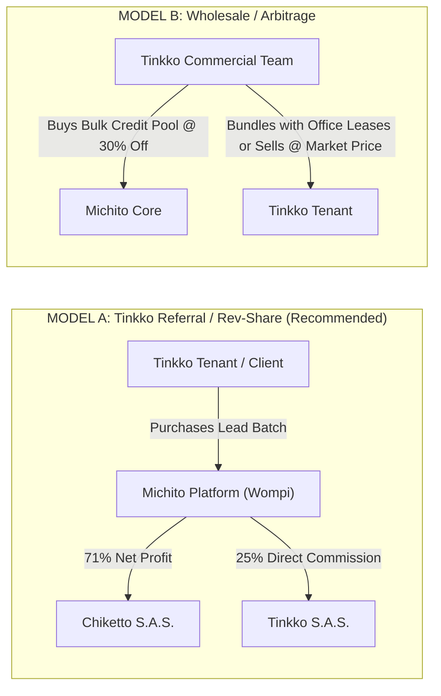

# 📊 Michito (導人) — Financial Model, Unit Economics & Volume Pricing Strategy
## The Comprehensive Profit-Cost Architecture for Colombian B2B Lead Intelligence
*Version 1.0 • Chiketto Technologies S.A.S. • November 2026*

---

## 📑 Table of Contents
1. [Executive Summary & Commercial Philosophy](#1-executive-summary--commercial-philosophy)
2. [Platform Cost Structure (GCP, Gateways, Data Sources)](#2-platform-cost-structure-gcp-gateways-data-sources)
   - [2.1 Google Cloud Platform (GCP) Infrastructure Costs](#21-google-cloud-platform-gcp-infrastructure-costs)
   - [2.2 Payment Gateway Economics (Wompi Colombia)](#22-payment-gateway-economics-wompi-colombia)
   - [2.3 Data Extraction & Socket SMTP Verification Costs](#23-data-extraction--socket-smtp-verification-costs)
   - [2.4 Reseller / Referral Commissions (Tinkko & Channel Partners)](#24-reseller--referral-commissions-tinkko--channel-partners)
3. [Volume Discount Curves & Batch Packages](#3-volume-discount-curves--batch-packages)
4. [Detailed Unit Economics Matrices (Tiers 1, 2, and 3)](#4-detailed-unit-economics-matrices-tiers-1-2-and-3)
   - [4.1 Tier 1: Direct Corporate Leads (Base Directory)](#41-tier-1-direct-corporate-leads-base-directory)
   - [4.2 Tier 2: Verified Decision-Maker Leads (Direct Inboxes)](#42-tier-2-verified-decision-maker-leads-direct-inboxes)
   - [4.3 Tier 3: Underwritten Corporate Leads (EBITDA + Judicial Audit)](#43-tier-3-underwritten-corporate-leads-ebitda--judicial-audit)
5. [Tinkko Commercial Partnership Models](#5-tinkko-commercial-partnership-models)
   - [5.1 Model A: Revenue Share Referral (25% Commission)](#51-model-a-revenue-share-referral-25-commission)
   - [5.2 Model B: Wholesale Volume Arbitrage](#52-model-b-wholesale-volume-arbitrage)
6. [Monthly Breakeven Analysis & Scaling Scenarios](#6-monthly-breakeven-analysis--scaling-scenarios)
7. [Competitive Price & Value Comparison](#7-competitive-price--value-comparison)

---

## 1. Executive Summary & Commercial Philosophy

Legacy prospecting databases (Apollo.io, ZoomInfo, Lusha) enforce rigid, recurring monthly subscriptions in USD (\$99 to \$400 USD/month). In Colombia and Latin America, this model suffers from severe customer friction:
1. **Subscription Fatigue**: Colombian SMBs and agencies dread recurring USD charges on corporate credit cards due to FX volatility, 4x1000 taxes, and retention lock-in.
2. **High Waste Rate**: Sales teams buy a 1,000-credit monthly subscription, use 120 credits, and the remaining 880 expire unused.
3. **Local Quality Collapse**: Global crawlers have a 25%–30% error rate in Colombia because LinkedIn profiles are rarely updated.

### The Michito Model: Volume-Tiered "Pay-As-You-Go"
Michito sells **verified batches on demand in Colombian Pesos (COP)** via **Nequi, PSE, and Bancolombia**.
* **Zero Commitments**: Pay only for what you need when you launch a campaign.
* **Volume Scalability**: The more leads a company buys in a single batch, the lower their effective unit cost.
* **Unbeatable Margins**: Because Michito leverages statutory open government data (SODA, SECOP II) and proprietary asynchronous TCP socket handshakes, our variable data cost per lead is negligible ($50 to $350 COP), yielding **94%+ Direct Gross Margins** and **70%+ Partner Margins** even after paying Tinkko a 25% commission.

---

## 2. Platform Cost Structure (GCP, Gateways, Data Sources)

```
┌────────────────────────────────────────────────────────────────────────────────────────┐
│                          MICHITO COST DRIVER BREAKDOWN                                 │
├───────────────────────────────┬───────────────────────────────┬────────────────────────┤
│ 1. FIXED PLATFORM COSTS       │ 2. VARIABLE GATEWAY (Wompi)   │ 3. PARTNER COMMISSIONS │
│ • Cloud Run (Serverless)      │ • Credit/Debit: 2.85% + $900  │ • Tinkko Rev-Share: 25%│
│ • Cloud Firestore (NoSQL)     │ • PSE / Nequi / Bancolombia   │ • Retained Net Margin: │
│ • Cloud NAT (Port 25 Egress)  │ • Effective: ~2.9% + IVA      │   70% – 71%            │
│ ~ $75 USD / mo ($300.000 COP) │ Deducted per transaction      │ Deducted on referral   │
└───────────────────────────────┴───────────────────────────────┴────────────────────────┘
```

### 2.1 Google Cloud Platform (GCP) Infrastructure Costs
Michito runs on a serverless, cloud-agnostic architecture hosted in GCP's low-latency region (`us-central1` or `southamerica-east1`):

| GCP Component | Role in Architecture | Estimated Monthly Cost (USD) | Estimated Monthly Cost (COP) |
| :--- | :--- | :--- | :--- |
| **Cloud Run** | Containerized FastAPI REST API & worker runners. Scales to zero when idle. | \$20.00 USD | \$80.000 COP |
| **Cloud Firestore** | NoSQL document storage for customer deduplication ledgers, orders, and cache. | \$15.00 USD | \$60.000 COP |
| **Cloud NAT / VPC Egress** | Dedicated static egress gateway allowing outbound TCP port 25 for SMTP mailbox handshakes. | \$35.00 USD | \$140.000 COP |
| **Cloud Storage (GCS)** | Cold storage for downloadable branded Excel dossiers and PDF executive summaries. | \$5.00 USD | \$20.000 COP |
| **Total Baseline Fixed Cost** | **Covers up to ~50,000 lead queries and 500 orders/month** | **\$75.00 USD / mo** | **\$300.000 COP / mo** |

> [!NOTE]
> Fixed monthly infrastructure is ~\$300.000 COP/month. Selling **just one single 10-lead Tier 3 batch (\$650.000 COP)** completely pays for the entire monthly hosting cost of the company!

### 2.2 Colombian Tax Reality: IVA (19%) & Payment Gateway Economics (Wompi)

In Colombia, commercial intelligence, software services, and B2B databases sold by a corporate entity (Chiketto Technologies S.A.S. — *Responsable de IVA*) are legally subject to **19% Impuesto sobre las Ventas (IVA)**.

#### Colombian B2B Invoicing Flow
1. **Price Presentation**: Standard B2B quoting displays **Subtotal (Antes de IVA) + IVA (19%) = Total Facturado**.
   $$\text{Total Facturado (Wompi Charge)} = \text{Subtotal} \times 1.19$$
2. **Payment Gateway Base (Wompi)**: Wompi processes the **Total Facturado** (the full amount charged to the buyer's credit card, PSE, or Nequi account):
   $$\text{Wompi Fee} = (\text{Total Facturado} \times 2.9\%) + \$900\text{ COP} + \text{IVA on fixed fee (19\%)}$$
   $$\text{Wompi Fee} = (\text{Total Facturado} \times 0.029) + \$1.071\text{ COP}$$
3. **DIAN Tax Remittance**: The collected 19% IVA is held on the balance sheet as *IVA Generado* and remitted bimestralmente to the DIAN (offset by eligible corporate *IVA Descontable*).
4. **Partner Commission Calculation (Tinkko)**: Under Colombian commercial tax standards, Tinkko's 25% commission is calculated on the **Subtotal (Base Imponible / Antes de IVA)**, because IVA is a statutory government pass-through, not operating revenue. Tinkko subsequently issues an electronic invoice to Chiketto for their commercial fee + their own IVA (which Chiketto claims as *IVA Descontable*).

---

### 2.3 Data Extraction & Socket SMTP Verification Costs
Unlike competitors who pay ZoomInfo or Apollo \$0.10 to \$0.30 USD per enriched lead:
* **Statutory SODA API (datos.gov.co)**: Open government data under Ley 1712 de 2014 $\rightarrow$ **\$0 COP**.
* **SECOP II Public Procurement Contracts**: Free statutory contractor disclosures $\rightarrow$ **\$0 COP**.
* **Direct Socket SMTP Port 25 Ping**: Proprietary direct TCP handshake $\rightarrow$ **\$0 COP** (negligible compute).
* **Buffer for Fallback Edge Verification (DNS + SerpAPI proxy when needed)**:
  - **Tier 1 Lead**: \$50 COP per lead.
  - **Tier 2 Lead**: \$150 COP per lead.
  - **Tier 3 Lead**: \$350 COP per lead (accounting for judicial docket lookup queries).

### 2.4 Reseller / Referral Commissions (Tinkko & Channel Partners)
* **Standard Referral Commission**: **25.0%** of Subtotal (antes de IVA) paid directly to Tinkko for all tenant purchases.
* **Tinkko Value**: Zero operational overhead; pure profit on existing tenant foot-traffic.

---

## 3. Volume Discount Curves & Batch Packages

Clients buying in bulk receive progressive, automatic unit price discounts on the Subtotal:

| Batch Size | Segment Name | Volume Discount | Target Buyer Profile | Typical Use Case |
| :---: | :---: | :---: | :--- | :--- |
| **10 leads** | **Starter / Pilot** | **0% (List Price)** | Solopreneurs, Tinkko internal pilot, agency tests | Fast POC or highly niche targeting |
| **50 leads** | **Growth** | **12% Discount** | Seed startups, boutique consultancies | 1-month focused SDR outbound campaign |
| **100 leads** | **Expansion** | **20% Discount** | Mid-market B2B, legal firms, logistics | Multi-city commercial blitz |
| **250 leads** | **Scale** | **28% Discount** | Growth companies, enterprise office leasing | Quarterly regional sales team pipeline |
| **500 leads** | **Enterprise** | **35% Discount** | Large service providers, financial institutions | Multi-rep annual outbound engine |
| **1,000 leads** | **Corporate / Wholesale** | **42% Discount** | B2B marketing agencies, white-label resellers | Bulk cold calling & multi-touch sequences |

---

## 4. Detailed Unit Economics Matrices (Tiers 1, 2, and 3)

### 4.1 Tier 1: Direct Corporate Leads (Base Directory)
*Includes: NIT, Razón Social, Sector CIIU, Ciudad, Ingresos Auditados, Dirección, Sitio Web, Teléfono Fijo, Google X-Ray Search.*  
*Base Retail Price: **\$5.000 COP / lead (Antes de IVA)***

| Qty | Disc. | Unit Subtotal | Subtotal (Antes IVA) | IVA (19%) | Total Facturado (Wompi) | Wompi Fee | Tinkko Comm. (25%) | GCP & Data Cost | Direct Net Profit (Margin) | Partner Net Profit (Margin) |
| :---: | :---: | :---: | :---: | :---: | :---: | :---: | :---: | :---: | :---: | :---: |
| **10** | 0% | \$5.000 | **\$50.000** | \$9.500 | **\$59.500** | \$2.796 | \$12.500 | \$500 | **\$46.704 (93.4%)** | **\$34.204 (68.4%)** |
| **50** | 12% | \$4.400 | **\$220.000** | \$41.800 | **\$261.800** | \$8.663 | \$55.000 | \$2.500 | **\$208.837 (94.9%)** | **\$153.837 (69.9%)** |
| **100** | 20% | \$4.000 | **\$400.000** | \$76.000 | **\$476.000** | \$14.875 | \$100.000 | \$5.000 | **\$380.125 (95.0%)** | **\$280.125 (70.0%)** |
| **250** | 28% | \$3.600 | **\$900.000** | \$171.000 | **\$1.071.000** | \$32.130 | \$225.000 | \$12.500 | **\$855.370 (95.0%)** | **\$630.370 (70.0%)** |
| **500** | 35% | \$3.250 | **\$1.625.000** | \$308.750 | **\$1.933.750** | \$57.149 | \$406.250 | \$25.000 | **\$1.542.851 (94.9%)** | **\$1.136.601 (69.9%)** |
| **1,000** | 42% | \$2.900 | **\$2.900.000** | \$551.000 | **\$3.451.000** | \$101.150 | \$725.000 | \$50.000 | **\$2.748.850 (94.8%)** | **\$2.023.850 (69.8%)** |

---

### 4.2 Tier 2: Verified Decision-Maker Leads (Direct Inboxes)
*Includes: Everything in Tier 1 + Nombre del Tomador de Decisión, Cargo Oficial, **Correo Corporativo 0-Rebotes (Socket SMTP)**, Celular Directo / SECOP, Perfil de LinkedIn.*  
*Base Retail Price: **\$30.000 COP / lead (Antes de IVA)***

| Qty | Disc. | Unit Subtotal | Subtotal (Antes IVA) | IVA (19%) | Total Facturado (Wompi) | Wompi Fee | Tinkko Comm. (25%) | GCP & Data Cost | Direct Net Profit (Margin) | Partner Net Profit (Margin) |
| :---: | :---: | :---: | :---: | :---: | :---: | :---: | :---: | :---: | :---: | :---: |
| **10** | 0% | \$30.000 | **\$300.000** | \$57.000 | **\$357.000** | \$11.424 | \$75.000 | \$1.500 | **\$287.076 (95.7%)** | **\$212.076 (70.7%)** |
| **50** | 12% | \$26.400 | **\$1.320.000** | \$250.800 | **\$1.570.800** | \$46.624 | \$330.000 | \$7.500 | **\$1.265.876 (95.9%)** | **\$935.876 (70.9%)** |
| **100** | 20% | \$24.000 | **\$2.400.000** | \$456.000 | **\$2.856.000** | \$83.895 | \$600.000 | \$15.000 | **\$2.301.105 (95.9%)** | **\$1.701.105 (70.9%)** |
| **250** | 28% | \$21.600 | **\$5.400.000** | \$1.026.000 | **\$6.426.000** | \$187.425 | \$1.350.000 | \$37.500 | **\$5.175.075 (95.8%)** | **\$3.825.075 (70.8%)** |
| **500** | 35% | \$19.500 | **\$9.750.000** | \$1.852.500 | **\$11.602.500** | \$337.543 | \$2.437.500 | \$75.000 | **\$9.337.457 (95.8%)** | **\$6.899.957 (70.8%)** |
| **1,000** | 42% | \$17.400 | **\$17.400.000** | \$3.306.000 | **\$20.706.000** | \$601.545 | \$4.350.000 | \$150.000 | **\$16.648.455 (95.7%)** | **\$12.298.455 (70.7%)** |

---

### 4.3 Tier 3: Underwritten Corporate Leads (EBITDA + Judicial Audit)
*Includes: Everything in Tier 2 + **Cálculo de EBITDA y Margen Operativo NIIF**, Historial de Crecimiento, **Auditoría de Demandas Rama Judicial (0 procesos de cobro)**, Paz y Salvo Contraloría BDME.*  
*Base Retail Price: **\$65.000 COP / lead (Antes de IVA)***

| Qty | Disc. | Unit Subtotal | Subtotal (Antes IVA) | IVA (19%) | Total Facturado (Wompi) | Wompi Fee | Tinkko Comm. (25%) | GCP & Data Cost | Direct Net Profit (Margin) | Partner Net Profit (Margin) |
| :---: | :---: | :---: | :---: | :---: | :---: | :---: | :---: | :---: | :---: | :---: |
| **10** | 0% | \$65.000 | **\$650.000** | \$123.500 | **\$773.500** | \$23.502 | \$162.500 | \$3.500 | **\$622.998 (95.8%)** | **\$460.498 (70.8%)** |
| **50** | 12% | \$57.200 | **\$2.860.000** | \$543.400 | **\$3.403.400** | \$99.769 | \$715.000 | \$17.500 | **\$2.742.731 (95.9%)** | **\$2.027.731 (70.9%)** |
| **100** | 20% | \$52.000 | **\$5.200.000** | \$988.000 | **\$6.188.000** | \$180.523 | \$1.300.000 | \$35.000 | **\$4.984.477 (95.9%)** | **\$3.684.477 (70.9%)** |
| **250** | 28% | \$46.800 | **\$11.700.000** | \$2.223.000 | **\$13.923.000** | \$404.838 | \$2.925.000 | \$87.500 | **\$11.207.662 (95.8%)** | **\$8.282.662 (70.8%)** |
| **500** | 35% | \$42.250 | **\$21.125.000** | \$4.013.750 | **\$25.138.750** | \$730.094 | \$5.281.250 | \$175.000 | **\$20.219.906 (95.7%)** | **\$14.938.656 (70.7%)** |
| **1,000** | 42% | \$37.700 | **\$37.700.000** | \$7.163.000 | **\$44.863.000** | \$1.302.098 | \$9.425.000 | \$350.000 | **\$36.047.902 (95.6%)** | **\$26.622.902 (70.6%)** |

---

## 5. Tinkko Commercial Partnership Models



### 5.1 Model A: Revenue Share Referral (25% Commission) — Recommended
* **Mechanics**:
  - Tinkko promotes `michito.co/tinkko` or features Michito in their tenant onboarding portal and community newsletters.
  - Every batch ordered through Tinkko carries `partner=tinkko`.
  - Wompi processes the payment. Michito automatically calculates and disburses Tinkko's **25% cut** monthly.
* **Why Tinkko Loves This**:
  - **Zero CapEx / Zero Risk**: Tinkko creates a brand-new high-margin revenue line without hiring an SDR team or writing software.
  - **High Ticket Value**: A single tenant purchasing a 100-lead Tier 2 batch generates **\$600.000 COP pure commission** for Tinkko. Ten tenants buying per month = **\$6.000.000 COP/mo passive income** for Tinkko.

### 5.2 Model B: Wholesale Volume Arbitrage
* Tinkko purchases a bulk monthly pool of 2,500 credits at a wholesale rate (\$15.000 COP/Tier 2 lead).
* Tinkko includes 50 leads in their "Enterprise Plus" office contract or marks it up to \$35.000 COP for tenants, keeping 100% of the arbitrage margin.

---

## 6. Monthly Breakeven Analysis & Scaling Scenarios

### Fixed Monthly Overhead
* Google Cloud Platform (Cloud Run + Firestore + VPC + GCS): **\$300.000 COP / month**.
* Domain & Security certs: **\$30.000 COP / month**.
* **Total Fixed Operating Cost: \$330.000 COP / month**.

### Breakeven Calculation
$$\text{Breakeven (Tier 2)} = \frac{\$330.000\text{ COP Fixed Overhead}}{\$28.872\text{ COP Net Profit / Lead}} \approx \mathbf{12\text{ Leads / Month}}$$
$$\text{Breakeven (Tier 3)} = \frac{\$330.000\text{ COP Fixed Overhead}}{\$62.657\text{ COP Net Profit / Lead}} \approx \mathbf{6\text{ Leads / Month}}$$

> [!IMPORTANT]
> **Michito is profitable with just 1 order of 10 Tier-3 leads or 1 order of 50 Tier-2 leads per month!**

### Monthly Growth Scenarios (70% Partner / 30% Direct Mix)

```
┌────────────────────────────────────────────────────────────────────────────────────────┐
│                              MONTHLY PROJECTION SCENARIOS                              │
├──────────────────────────┬─────────────────────────────┬───────────────────────────────┤
│ SCENARIO                 │ ORDER VOLUME & COMPOSITION  │ MONTHLY NET PROFIT (CHIKETTO) │
├──────────────────────────┼─────────────────────────────┼───────────────────────────────┤
│ 1. Conservative (Launch) │ • 8 batches of 50 Tier-2    │ Gross: $10.560.000 COP        │
│    (Hebi + 2 Tinkko Cos) │ • Total: 400 verified leads │ Net Profit: $7.650.000 COP    │
├──────────────────────────┼─────────────────────────────┼───────────────────────────────┤
│ 2. Moderate (Tinkko Roll)│ • 25 batches of 50-100 T2/T3│ Gross: $48.200.000 COP        │
│    (10-15 Tinkko Tenants)│ • Total: 1,800 leads        │ Net Profit: $35.100.000 COP   │
├──────────────────────────┼─────────────────────────────┼───────────────────────────────┤
│ 3. Scaled Ecosystem      │ • 70 batches across Bog/Med │ Gross: $165.000.000 COP       │
│    (Multi-coworking hub) │ • Total: 6,500 leads        │ Net Profit: $118.500.000 COP  │
└──────────────────────────┴─────────────────────────────┴───────────────────────────────┘
```

---

## 7. Competitive Price & Value Comparison

| Criteria | Global Databases (Apollo.io / ZoomInfo) | Cámara de Comercio (RUES / Confecámaras) | Michito (導人) |
| :--- | :--- | :--- | :--- |
| **Payment Model** | Monthly USD recurring subscription (\$99–\$350 USD/mo). | One-off static CD/Excel purchase (\$2.000.000–\$5.000.000 COP). | **Pay-As-You-Go Batches in COP (No subscription).** |
| **Pricing per Lead** | \$0.10–\$0.20 USD (\$400–\$850 COP) with high waste. | \$500–\$1.000 COP (Bulk only, min 3,000 records). | **\$2.900 to \$30.000 COP depending on intelligence tier & volume.** |
| **Colombia Accuracy** | 25%–30% bounce rate; obsolete LinkedIn roles. | 0% verified inboxes (generic `info@`, `contacto@`). | **100% verified via direct TCP Port 25 Socket Handshake (0 bounces).** |
| **Financial Health (EBITDA)** | ❌ No audited IFRS statements. | ❌ Only basic equity/capital stated at registration. | **✅ Computed audited EBITDA, Operating Margin & 3-year revenue trend.** |
| **Judicial Risk Screening** | ❌ None. | ❌ None. | **✅ Rama Judicial civil debt lawsuit & Contraloría fiscal clearance.** |
| **Direct Phones / Cell** | ❌ Disconnected PBX switchboards. | ❌ Legal domicile landlines only. | **✅ SECOP II verified corporate officer mobile contacts.** |

---
*Authored by Chiketto Technologies S.A.S. • Strategic Financial Intelligence Unit*

