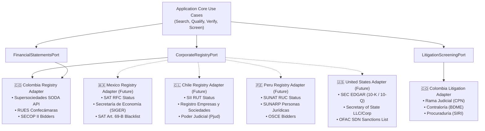
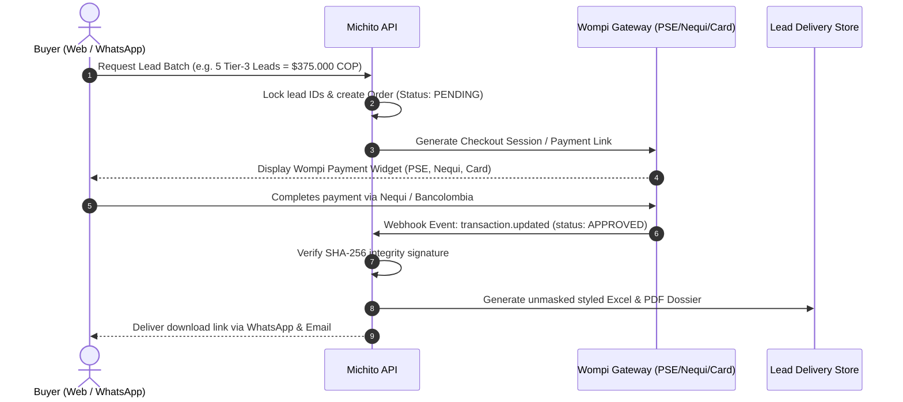

# 🎯 Michito (導人) — Strategic Architecture & Master Engineering Plan
## The High-Precision B2B Lead Intelligence, Risk Screening & Verification Platform
*Version 2.5 • Clean & Onion Architecture • Cloud-Agnostic Core • Multi-Country Expansion • Corporate Solvency & Litigation Intelligence*  
*Chiketto Technologies S.A.S. • October 2026*

---

## 📑 Table of Contents
1. [Executive Summary & Strategic Vision](#1-executive-summary--strategic-vision)
2. [API Architecture: Clean & Onion Architecture (Cloud-Agnostic Core)](#2-api-architecture-clean--onion-architecture-cloud-agnostic-core)
   - [2.1 The Dependency Inversion Principle & Concentric Rings](#21-the-dependency-inversion-principle--concentric-rings)
   - [2.2 Project Directory Structure](#22-project-directory-structure)
   - [2.3 Multi-Cloud Portability Blueprint (GCP, AWS, Azure, Bare-Metal)](#23-multi-cloud-portability-blueprint-gcp-aws-azure-bare-metal)
   - [2.4 Inversion of Control & Dependency Injection Container](#24-inversion-of-control--dependency-injection-container)
3. [Pluggable Multi-Country Expansion Architecture (Official Government Registries)](#3-pluggable-multi-country-expansion-architecture-official-government-registries)
   - [3.1 Pluggable Registry Provider Interface](#31-pluggable-registry-provider-interface)
   - [3.2 Country 1: Colombia (CO — Immediate Priority Launchpad)](#32-country-1-colombia-co--immediate-priority-launchpad)
   - [3.3 Country 2: Mexico (MX — Phase 4 Regional Expansion)](#33-country-2-mexico-mx--phase-4-regional-expansion)
   - [3.4 Country 3: Chile (CL — Phase 4 Regional Expansion)](#34-country-3-chile-cl--phase-4-regional-expansion)
   - [3.5 Country 4: Peru (PE — Phase 4 Regional Expansion)](#35-country-4-peru-pe--phase-4-regional-expansion)
   - [3.6 Country 5: United States (US — Cross-Border & Foreign Trade)](#36-country-5-united-states-us--cross-border--foreign-trade)
4. [Advanced Corporate Intelligence: Financial Health (EBITDA) & Legal Litigation Risk](#4-advanced-corporate-intelligence-financial-health-ebitda--legal-litigation-risk)
   - [4.1 Audited EBITDA & Profitability Solvency Engine](#41-audited-ebitda--profitability-solvency-engine)
   - [4.2 Legal Litigation & Judicial Screening Engine](#42-legal-litigation--judicial-screening-engine)
   - [4.3 Fiscal & Disciplinary Background Checks (Contraloría / Procuraduría / DIJIN)](#43-fiscal--disciplinary-background-checks-contralor%C3%ADa--procuradur%C3%ADa--dijin)
   - [4.4 Composite Lead Scoring Algorithm (0 to 100 Quality Index)](#44-composite-lead-scoring-algorithm-0-to-100-quality-index)
5. [The Zero-Ban Verification Engine (Prospeo-Grade Mailbox Pings & Safe Google X-Ray)](#5-the-zero-ban-verification-engine-prospeo-grade-mailbox-pings--safe-google-x-ray)
   - [5.1 Direct Socket SMTP Handshake Protocol (`RCPT TO` Ping)](#51-direct-socket-smtp-handshake-protocol-rcpt-to-ping)
   - [5.2 Catch-All Server Detection & Resolution](#52-catch-all-server-detection--resolution)
   - [5.3 Safe Zero-Ban Google X-Ray Intelligence](#53-safe-zero-ban-google-x-ray-intelligence)
6. [User Experience: Frictionless "Direct Buy" vs. Enterprise Accounts](#6-user-experience-frictionless-direct-buy-vs-enterprise-accounts)
7. [Monetization & Wompi Payment Architecture](#7-monetization--wompi-payment-architecture)
8. [Multi-Environment Lifecycle Strategy (local-dev, staging, prod)](#8-multi-environment-lifecycle-strategy-local-dev-staging-prod)
9. [Multi-Channel Distribution (WhatsApp Bot, Web Portal, Voice Assistants)](#9-multi-channel-distribution-whatsapp-bot-web-portal-voice-assistants)
10. [Detailed Phase-by-Phase Implementation Roadmap](#10-detailed-phase-by-phase-implementation-roadmap)
11. [Legal, Privacy & Regulatory Compliance (Habeas Data & Ley 1581)](#11-legal-privacy--regulatory-compliance-habeas-data--ley-1581)

---

## 1. Executive Summary & Strategic Vision

**Michito (導人 / 道途)** — derived from the Japanese *Michibiku* ("to guide, to lead, to show the true path") — is a modular, cloud-agnostic B2B Corporate Intelligence and Lead Verification Platform.

### The Problem in Latin America & Colombia
1. **Global Databases Fail Locally**: Global scraping platforms (Apollo.io, ZoomInfo, Prospeo, Lusha) suffer from a **27%–30% error rate in Colombia and Latin America**. Their crawlers index obsolete LinkedIn titles, disconnected phone extensions, and dead emails because employee turnover in LATAM is high and LinkedIn profiles are rarely updated.
2. **Traditional Registries are Static Dumps**: Chamber of Commerce (RUES / Confecámaras) sells bulk records for millions of COP that contain generic info emails (`info@`, `contacto@`, `recepcion@`), zero direct decision-maker routing, and zero mailbox verification.
3. **The Credit & Default Blindspot**: Sales teams waste weeks prospecting companies that are legally active but actively facing multi-million peso debt lawsuits (*procesos ejecutivos de cobro*), insolvency restructuring, or negative EBITDA cash burn, leading directly to toxic accounts receivable.

### The Michito Solution
Michito merges **official statutory corporate transparency registries** with **real-time financial underwriting**, **judicial litigation screening**, and **deep zero-ban contact verification**:
* **Official Registry Truth**: Real registered corporate entities with audited IFRS (NIIF) financial statements.
* **Solvency Intelligence**: Computed operating revenue, operating margin, and **EBITDA**.
* **Litigation Risk Screening**: Real-time screening against Judicial Branch dockets (Rama Judicial), fiscal debtor records (Contraloría BDME), and disciplinary sanctions.
* **0-Bounce Mail Server Handshakes**: Direct TCP socket verification (`RCPT TO` ping) confirming inboxes physically exist without sending spam.
* **Zero-Ban Decision-Maker Discovery**: Pre-computed Google X-Ray links caching live LinkedIn profiles with zero scraper footprint and zero IP ban risk.

---

## 2. API Architecture: Clean & Onion Architecture (Cloud-Agnostic Core)

To guarantee that Michito can easily be migrated between **Google Cloud, AWS, Azure, or Bare-Metal Linux servers** without modifying a single line of business logic, the entire API strictly adheres to **Clean Architecture (Onion Architecture)** principles.

### 2.1 The Dependency Inversion Principle & Concentric Rings

Dependencies flow strictly **inward**. Inner layers have zero awareness or imports of outer layers:

```
┌──────────────────────────────────────────────────────────────────────────────────┐
│                           MICHITO ONION ARCHITECTURE                             │
└──────────────────────────────────────────────────────────────────────────────────┘

              [LAYER 4: INFRASTRUCTURE & FRAMEWORKS (External Plugins)]
         ┌────────────────────────────────────────────────────────────────────┐
         │ FastAPI Web Routers • Click CLI • WhatsApp Cloud API Webhooks      │
         │ Wompi / Stripe Gateways • Firestore / PostgreSQL / SQLite          │
         │ Supersociedades SODA API • Rama Judicial Scrapers • Cloud Run/ECS  │
         │                                                                    │
         │           [LAYER 3: INTERFACE ADAPTERS (Translators)]              │
         │     ┌────────────────────────────────────────────────────────┐     │
         │     │ Repositories • SmtpSocketVerifier • PaymentGateways    │     │
         │     │ CountryRegistryAdapters (CO, MX, CL, PE, US) • DTOs    │     │
         │     │                                                        │     │
         │     │           [LAYER 2: APPLICATION (Use Cases & Ports)]   │     │
         │     │     ┌────────────────────────────────────────────┐     │     │
         │     │     │ SearchQualifiedCompaniesUseCase            │     │     │
         │     │     │ CalculateCompanyEbitdaUseCase              │     │     │
         │     │     │ ScreenLitigationRiskUseCase                │     │     │
         │     │     │ VerifyContactMailboxUseCase                │     │     │
         │     │     │ CreateLeadOrderUseCase                     │     │     │
         │     │     │ FulfillPaymentWebhookUseCase               │     │     │
         │     │     │    [Outbound Ports / Driving Interfaces]   │     │     │
         │     │     │                                            │     │     │
         │     │     │         [LAYER 1: DOMAIN (Core Business)]  │     │     │
         │     │     │     ┌────────────────────────────────┐     │     │     │
         │     │     │     │ Company, DecisionMaker,        │     │     │     │
         │     │     │     │ TaxId, FinancialReport,        │     │     │     │
         │     │     │     │ EbitdaMargin, LitigationRecord,│     │     │     │
         │     │     │     │ LeadOrder, CreditAccount       │     │     │     │
         │     │     │     └────────────────────────────────┘     │     │     │
         │     │     └────────────────────────────────────────────┘     │     │
         │     └────────────────────────────────────────────────────────┘     │
         └────────────────────────────────────────────────────────────────────┘
```

#### Layer 1: Domain Core (Zero External Dependencies)
* Contains pure business entities, value objects, and domain exceptions.
* Uses only standard Python library (`dataclasses`, `enum`, `typing`, `decimal`).
* **Entities**: `Company`, `DecisionMaker`, `ContactVerification`, `LeadOrder`, `CreditAccount`.
* **Value Objects**: `TaxId` (handles check-digit math for NIT, RFC, RUT), `FinancialMetric` (Revenue, Operating Profit, EBITDA, Margin), `LitigationRecord`, `EmailAddress`, `ConfidenceScore`.

#### Layer 2: Application Layer (Use Cases & Abstract Ports)
* Contains application workflow orchestrations (Use Cases) and contracts (Abstract Base Classes / Protocols).
* Defines **Outbound Ports**:
  * `CorporateRegistryPort`: Interface for corporate lookups.
  * `FinancialStatementsPort`: Interface for audited IFRS balances & P&L statements.
  * `LitigationScreeningPort`: Interface for judicial and fiscal background checks.
  * `MailboxVerifierPort`: Interface for TCP socket mailbox verification.
  * `PaymentGatewayPort`: Interface for charging customers (Wompi, Stripe).
  * `LeadOrderRepositoryPort`: Interface for order & credit persistence.
  * `DeduplicationLedgerPort`: Interface for historical prospect tracking.

#### Layer 3: Interface Adapters
* Implements the ports defined by the Application layer.
* Translates domain entities into database schemas, third-party API payloads, or CSV/Excel outputs.
* Contains swappable adapters: `ColombiaSupersociedadesAdapter`, `RamaJudicialScreeningAdapter`, `FirestoreLeadRepositoryAdapter`, `PostgresLeadRepositoryAdapter`, `WompiPaymentGatewayAdapter`, `SocketSmtpVerifierAdapter`.

#### Layer 4: Infrastructure & Frameworks (Swappable Drivers)
* Web frameworks (FastAPI), CLI runners (Click/Typer), HTTP clients (`httpx`), Cloud SDKs (`google-cloud-firestore`, `boto3`, `azure-cosmos`), and socket networking.
* Nothing in the inner layers imports from Layer 4.

---

### 2.2 Project Directory Structure

```
michito/
├── config/                          # Environment configs (.env.local, .env.staging, .env.prod)
├── docs/
│   ├── strategy/                    # Architectural plans & strategic roadmaps
│   └── api/                         # OpenAPI / Swagger specs
├── src/
│   ├── domain/                      # Layer 1: Core Domain
│   │   ├── entities/
│   │   │   ├── company.py
│   │   │   ├── decision_maker.py
│   │   │   ├── financial_report.py
│   │   │   ├── litigation_record.py
│   │   │   └── lead_order.py
│   │   ├── value_objects/
│   │   │   ├── tax_id.py            # NIT, RFC, RUT validation rules
│   │   │   ├── ebitda_margin.py
│   │   │   ├── email_address.py
│   │   │   └── confidence_score.py
│   │   └── exceptions.py
│   │
│   ├── application/                 # Layer 2: Use Cases & Ports
│   │   ├── use_cases/
│   │   │   ├── search_companies.py
│   │   │   ├── calculate_ebitda.py
│   │   │   ├── screen_litigation_risk.py
│   │   │   ├── verify_mailbox.py
│   │   │   ├── create_lead_order.py
│   │   │   └── fulfill_wompi_webhook.py
│   │   ├── ports/                   # Abstract Interfaces
│   │   │   ├── corporate_registry_port.py
│   │   │   ├── financial_statements_port.py
│   │   │   ├── litigation_port.py
│   │   │   ├── mailbox_verifier_port.py
│   │   │   ├── payment_gateway_port.py
│   │   │   └── lead_order_repository_port.py
│   │   └── dto/                     # Data Transfer Objects
│   │       ├── search_request_dto.py
│   │       └── lead_dossier_dto.py
│   │
│   ├── adapters/                    # Layer 3: Adapters
│   │   ├── registries/              # Pluggable Country Adapters
│   │   │   ├── colombia/
│   │   │   │   ├── supersociedades_soda_adapter.py
│   │   │   │   ├── secop_adapter.py
│   │   │   │   └── rues_adapter.py
│   │   │   ├── mexico/              # Future
│   │   │   │   └── sat_rpc_adapter.py
│   │   │   └── chile/               # Future
│   │   │       └── sii_adapter.py
│   │   ├── litigation/
│   │   │   ├── rama_judicial_adapter.py
│   │   │   └── contraloria_bdme_adapter.py
│   │   ├── verifiers/
│   │   │   ├── socket_smtp_verifier_adapter.py
│   │   │   └── google_xray_adapter.py
│   │   ├── repositories/
│   │   │   ├── firestore_repository_adapter.py
│   │   │   ├── postgres_repository_adapter.py
│   │   │   └── memory_repository_adapter.py
│   │   ├── payments/
│   │   │   ├── wompi_adapter.py
│   │   │   └── stripe_adapter.py
│   │   └── messaging/
│   │       └── meta_whatsapp_adapter.py
│   │
│   └── entrypoints/                 # Layer 4: Infrastructure & Delivery
│       ├── api/
│       │   ├── main.py              # FastAPI app initialization
│       │   ├── dependencies.py      # FastAPI Dependency Injection
│       │   ├── routers/
│       │   │   ├── prospects.py
│       │   │   ├── verification.py
│       │   │   ├── orders.py
│       │   │   └── webhooks.py
│       ├── cli/
│       │   └── main_cli.py          # Click CLI tool
│       └── container.py             # IoC / Dependency Injection Root
│
├── tests/
│   ├── unit/                        # Tests Domain & Application (Fast, no network)
│   ├── integration/                 # Tests Adapters with emulators / mocks
│   └── e2e/                         # Tests full HTTP endpoints
├── firebase.json                    # Firebase Emulator Suite config
├── Dockerfile                       # Production container
└── docker-compose.yml               # Local development stack
```

---

### 2.3 Multi-Cloud Portability Blueprint (GCP, AWS, Azure, Bare-Metal)

The Clean Architecture allows Michito to move seamlessly between cloud providers:

| Capability | Google Cloud Platform (Default) | Amazon Web Services (Alternate) | Microsoft Azure (Alternate) | Bare-Metal / Dedicated VPS |
| :--- | :--- | :--- | :--- | :--- |
| **Compute / API Engine** | **Cloud Run** (Docker Container) | **ECS Fargate** / App Runner | **Azure Container Apps** | **Docker Compose / Systemd** |
| **Database Port** | Cloud Firestore | Amazon DynamoDB or Aurora Postgres | Azure CosmosDB or Azure Postgres | PostgreSQL 16 (Local) |
| **Outbound Port 25 (SMTP Handshakes)** | Cloud Run VPC connector or dedicated socket worker | ECS Fargate or EC2 with port 25 unblocked | Azure VM or Container Apps with unblocked egress | Direct native TCP socket (No port 25 block!) |
| **Background Tasks** | Cloud Tasks / Cloud Run Jobs | AWS SQS / Lambda | Azure Service Bus | Redis + Celery / ARQ |
| **Secret Management** | Secret Manager | AWS Secrets Manager | Azure Key Vault | `.env` / Vault |

> [!IMPORTANT]
> **Port 25 Socket SMTP Constraint**: Serverless platforms like Google Cloud Functions or AWS Lambda block raw outbound TCP port 25 to prevent spambots. Michito's API runs containerized on **Cloud Run** or a **dedicated VPS**, where raw outbound TCP sockets are allowed.

---

### 2.4 Inversion of Control & Dependency Injection Container

The dependency injection root (`src/entrypoints/container.py`) instantiates concrete adapters based on environment variables, leaving use cases decoupled:

```python
class Container:
    def __init__(self, settings: Settings):
        self.settings = settings
        
        # 1. Database Repository Adapter
        if settings.DB_DRIVER == "firestore":
            self.order_repo = FirestoreLeadRepositoryAdapter(
                project_id=settings.GCP_PROJECT_ID,
                emulator_host=settings.FIRESTORE_EMULATOR_HOST
            )
        elif settings.DB_DRIVER == "postgres":
            self.order_repo = PostgresLeadRepositoryAdapter(dsn=settings.DATABASE_URL)
        else:
            self.order_repo = MemoryLeadRepositoryAdapter()
            
        # 2. Pluggable Country Registries
        self.co_registry = ColombiaSupersociedadesAdapter(soda_token=settings.SODA_APP_TOKEN)
        self.co_litigation = RamaJudicialAdapter()
        
        # 3. Mailbox Verifier Adapter
        self.mailbox_verifier = SocketSmtpVerifierAdapter(
            helo_domain=settings.SMTP_HELO_DOMAIN,
            mail_from=settings.SMTP_MAIL_FROM
        )
        
        # 4. Payment Gateway Adapter
        self.payment_gateway = WompiPaymentGatewayAdapter(
            public_key=settings.WOMPI_PUBLIC_KEY,
            private_key=settings.WOMPI_PRIVATE_KEY,
            integrity_secret=settings.WOMPI_INTEGRITY_SECRET
        )
        
        # 5. Wire Application Use Cases
        self.search_companies_use_case = SearchQualifiedCompaniesUseCase(
            registry_port=self.co_registry,
            litigation_port=self.co_litigation
        )
        self.verify_mailbox_use_case = VerifyContactMailboxUseCase(
            verifier_port=self.mailbox_verifier
        )
        self.create_order_use_case = CreateLeadOrderUseCase(
            order_repo=self.order_repo,
            payment_gateway=self.payment_gateway
        )
```

---

## 3. Pluggable Multi-Country Expansion Architecture (Official Government Registries)

While **Colombia** is the primary launchpad, Michito's domain understands generic corporate entities (`TaxId`, `CorporateEntity`, `FinancialFiling`, `LitigationDocket`). Country-specific logic is entirely isolated into **Pluggable Country Adapters**.



---

### 3.1 Pluggable Registry Provider Interface

```python
class CountryRegistryProvider(ABC):
    @property
    @abstractmethod
    def country_code(self) -> str:
        """Returns 2-letter country code (e.g. 'co', 'mx', 'cl', 'pe', 'us')."""
        pass

    @property
    @abstractmethod
    def currency(self) -> str:
        """Returns 3-letter currency code (e.g. 'COP', 'MXN', 'CLP', 'PEN', 'USD')."""
        pass

    @abstractmethod
    def validate_tax_id(self, tax_id: str) -> bool:
        """Validates country-specific tax identifier mathematical checksum."""
        pass

    @abstractmethod
    async def fetch_companies(self, filter: CompanyFilterDto) -> List[Company]:
        """Fetches corporate entities meeting revenue, industry, and city filters."""
        pass

    @abstractmethod
    async def get_financial_statements(self, tax_id: str) -> Optional[FinancialReport]:
        """Fetches audited balance sheets, income statements, and calculated EBITDA."""
        pass

    @abstractmethod
    async def screen_litigation(self, tax_id: str, company_name: str) -> LitigationReport:
        """Queries official judicial and fiscal registries for lawsuits and debt proceedings."""
        pass
```

---

### 3.2 Country 1: Colombia (CO — Immediate Priority Launchpad)

Colombia represents the initial market moat where Michito provides 100% verified intelligence:

| Government Organization | Public Registry / API | Extracted Intelligence | Verification Frequency |
| :--- | :--- | :--- | :--- |
| **Superintendencia de Sociedades** | SODA Open Data API (`datos.gov.co` NIIF datasets) | Audited Operating Revenue, Operating Profit (EBIT), Depreciation, Total Assets, Total Liabilities. | Annual filing sync + weekly cache |
| **Confecámaras / Cámaras de Comercio** | RUES (Registro Único Empresarial y Social) | Active Merchant Registration (*Matrícula Mercantil Activa*), Official Legal Address, Registration City, CIIU Codes. | Real-time / 30-day cache |
| **Rama Judicial de Colombia** | Consulta de Procesos Nacional (CPN / Siglo XXI / Tyba) | Active Civil Debt Lawsuits (*Procesos Ejecutivos de Cobro*), Ordinary Labor Lawsuits, Insolvency Restructuring (Ley 1116). | On-demand lead qualification |
| **Contraloría General de la República** | Boletín de Responsables Fiscales (BDME) | Active fiscal debt sanctions against the enterprise or corporate officers. | On-demand lead qualification |
| **Procuraduría General de la Nación** | SIRI (Sistema de Información de Registro de Sanciones) | Disciplinary disqualifications of Legal Representatives. | On-demand lead qualification |
| **Colombia Compra Eficiente** | SECOP II (Public Procurement Portal) | Bidding records, government contract awards, verified corporate emails and direct cell phone numbers. | Continuous ingestion |
| **DIAN** | Consulta de Estado del RUT | Active tax status, Gran Contribuyente designation, Auto-retenedor status. | Real-time check |

---

### 3.3 Country 2: Mexico (MX — Phase 4 Regional Expansion)
* **SAT (Servicio de Administración Tributaria)**: Validation of RFC (Registro Federal de Contribuyentes) with official homoclave checksum calculation.
* **SAT Art. 69-B (Lista Negra de EFOS / EDOS)**: Automated screening against companies that simulate commercial operations (phantom/invoicing fraud).
* **Secretaría de Economía / RPC (Registro Público de Comercio - SIGER)**: Official commercial folio, bylaws, powers of attorney, and legal representatives.
* **Profeco / Buró Comercial**: Public consumer and commercial dispute records.

### 3.4 Country 3: Chile (CL — Phase 4 Regional Expansion)
* **SII (Servicio de Impuestos Internos)**: Corporate RUT validation (modulo 11 verification), tax category, electronic invoice issuance status.
* **Registro de Empresas y Sociedades (Tu Empresa en un Día / Min. Economía)**: Official corporate constitution, current active partners, and legal representatives.
* **Poder Judicial de Chile (Pjud)**: Civil executory claims, commercial collection lawsuits, and corporate insolvency filings under Ley 20.720.

### 3.5 Country 4: Peru (PE — Phase 4 Regional Expansion)
* **SUNAT (Superintendencia Nacional de Aduanas y de Administración Tributaria)**: RUC verification (11 digits, begins with 20 for juridical entities), fiscal domicile status (Habido / No Habido).
* **SUNARP (Superintendencia Nacional de los Registros Públicos)**: Registration in the Corporate Register (*Registro de Personas Jurídicas*), valid powers of attorney.
* **OSCE (Organismo Supervisor de las Contrataciones del Estado)**: State supplier registry (RNP), bidding history, and contractor sanctions.

### 3.6 Country 5: United States (US — Cross-Border & Foreign Trade)
* **SEC EDGAR**: 10-K (Annual audited reports) and 10-Q (Quarterly reports) for publicly listed corporations.
* **Secretary of State (SOS) Registries**: Corporate entity status across Delaware, Florida, Wyoming, Texas, California.
* **OFAC / SDN (Specially Designated Nationals)**: Sanctions and anti-money laundering (AML) blacklist screening.

---

## 4. Advanced Corporate Intelligence: Financial Health (EBITDA) & Legal Litigation Risk

Traditional lead generation lists give sales reps a company name and a cold email. Reps waste hours pitching companies that are broke, insolvent, or in court. Michito provides **Underwritten Corporate Leads**.

```
┌────────────────────────────────────────────────────────────────────────┐
│              MICHITO CORPORATE LEAD UNDERWRITING MATRIX                │
├────────────────────────────────┬───────────────────────────────────────┤
│ 1. SCALE & GROWTH              │ 2. CASHFLOW & SOLVENCY (EBITDA)       │
│ • Audited Operating Revenue    │ • Ganancia Operativa (EBIT)           │
│ • 3-Year YoY Revenue Trend     │ • Depreciación y Amortización         │
│ • Net Asset Base               │ • Computed EBITDA & EBITDA Margin     │
├────────────────────────────────┼───────────────────────────────────────┤
│ 3. LEGAL & LITIGATION RISK     │ 4. CONTACT VERIFICATION               │
│ • Rama Judicial Debt Lawsuits  │ • 0-Bounce Socket SMTP Ping           │
│ • Contraloría BDME Fiscal Risk │ • Decision-Maker Title Confidence     │
│ • Insolvency (Ley 1116) Status │ • Google X-Ray Cached Direct URL      │
└────────────────────────────────┴───────────────────────────────────────┘
```

---

### 4.1 Audited EBITDA & Profitability Solvency Engine

Under Colombian NIIF / IFRS accounting standards, commercial enterprises submit standardized financial statements to Superintendencia de Sociedades. Michito extracts these figures from public disclosure statements:

#### Mathematical Formula
From the **Statement of Comprehensive Income (Estado de Resultados Integral)**:
$$\text{EBIT} = \text{Operating Revenue (Ingresos de Actividades Ordinarias)} - \text{Cost of Sales} - \text{Operating Expenses}$$
$$\text{EBITDA} = \text{EBIT (Ganancia Operativa)} + \text{Depreciation} + \text{Amortization}$$
$$\text{EBITDA Margin (\%)} = \left( \frac{\text{EBITDA}}{\text{Operating Revenue}} \right) \times 100$$

#### Solvency Classification Tiers

| Solvency Tier | EBITDA Margin | Cashflow Profile | Sales Strategy Recommendation |
| :--- | :--- | :--- | :--- |
| **Tier 1 (AAA Cashflow)** | **> 20.0%** | Exceptional profitability; high liquidity; fast payers. | Premium enterprise pricing; immediate contract close. |
| **Tier 2 (AA Healthy)** | **8.0% – 20.0%** | Stable commercial operation; healthy cashflow generation. | Standard payment terms (30 days); prime sales target. |
| **Tier 3 (A Tight)** | **1.0% – 7.9%** | Low margin; sensitive to price increases or cash crunches. | Require 50% upfront deposit or strict credit terms. |
| **Alert (Distress Risk)** | **< 0% (Negative)** | Operating at a loss; cash burning; high default risk. | Flag as high risk: sell only on 100% advance payment. |

---

### 4.2 Legal Litigation & Judicial Screening Engine

When a Colombian company defaults on suppliers, landlords, or bank loans, the creditor files a **Proceso Ejecutivo de Cobro** before civil municipal or circuit judges. Michito screens this in real time:

#### Monitored Judicial Proceeding Categories
1. **Proceso Ejecutivo de Cobro (Civil Debt Enforcement)**:
   - Lawsuits enforcing payment of commercial invoices (*facturas cambiarias*), promissory notes (*pagarés*), or commercial leases (*cánones de arrendamiento*).
   - High volume of active executory proceedings = **imminent liquidity freeze**.
2. **Proceso Laboral Ordinario (Labor Disputes)**:
   - Lawsuits filed by former employees for unpaid wages, severance (*liquidaciones*), or social security contributions.
3. **Proceso de Reorganización Empresarial / Insolvencia (Ley 1116 de 2006)**:
   - The company is in formal bankruptcy debt restructuring under Supersociedades supervision. Existing debts are frozen by law.
4. **Proceso de Liquidación Judicial (Commercial Liquidation)**:
   - The company is shutting down and dissolving assets. Any prospective sale will result in an uncollectable loss.

---

### 4.3 Fiscal & Disciplinary Background Checks (Contraloría / Procuraduría / DIJIN)

* **Contraloría General (BDME)**: Screens the *Boletín de Responsables Fiscales*. Any entity listed has unfulfilled fiscal judgment debts with the Colombian state.
* **Procuraduría General (SIRI)**: Confirms the legal representative (*Representante Legal*) is not barred from entering commercial or public contracts.
* **AML / SARLAFT / OFAC Screening**: Verifies the enterprise, its tax ID, and its legal representatives are not on the Clinton List or international counter-terrorism financing lists.

---

### 4.4 Composite Lead Scoring Algorithm (0 to 100 Quality Index)

Michito calculates an objective **Lead Quality Score ($S$)** out of 100:

$$S = (W_{\text{rev}} \times S_{\text{rev}}) + (W_{\text{ebitda}} \times S_{\text{ebitda}}) + (W_{\text{lit}} \times S_{\text{lit}}) + (W_{\text{smtp}} \times S_{\text{smtp}})$$

Where weights reflect operational reality:
* **Financial Scale ($W_{\text{rev}} = 0.25$)**: Scale of annual revenue ($> \$10.000\text{M COP} = 100$).
* **Cashflow Solvency ($W_{\text{ebitda}} = 0.30$)**: EBITDA margin ($> 15\% = 100$, $0\% = 40$, $<0\% = 0$).
* **Litigation Health ($W_{\text{lit}} = 0.25$)**: Zero active debt lawsuits $= 100$; 1 minor lawsuit $= 70$; multiple executory lawsuits or insolvency $= 0$.
* **Contact Deliverability ($W_{\text{smtp}} = 0.20$)**: 0-bounce direct socket verified mailbox $= 100$; catch-all $= 50$; invalid $= 0$.

---

## 5. The Zero-Ban Verification Engine (Prospeo-Grade Mailbox Pings & Safe Google X-Ray)

Global tools scrape LinkedIn until their residential proxy pool is flagged, resulting in captcha blocks and account bans. Michito achieves **Prospeo-grade accuracy with zero bot footprint**.

```
┌────────────────────────────────────────────────────────────────────────┐
│                   MICHITO ZERO-BAN VERIFICATION FLOW                   │
└────────────────────────────────────────────────────────────────────────┘

    [Step 1: MX Lookup]  ──> Resolve DNS MX records & sort by priority
             │
    [Step 2: Socket Ping]──> Connect via TCP port 25 to Mail Server
             │
    [Step 3: Handshake]  ──> Send HELO/EHLO -> MAIL FROM: <verify@michito.co>
             │
    [Step 4: Probe]      ──> Send RCPT TO: <prospect@company.com>
             │               ├── Server replies 250 OK: Inactive/Active Inbox
             │               ├── Server replies 550 User Not Found: Inactive
             │               └── Server replies 450/421 Greylisting: Retry
             │
    [Step 5: Catch-All]  ──> Probe random string: RCPT TO: <xyz892jkl@company.com>
             │               ├── If 250 OK: Flag as "Catch-All Server"
             │               └── If 550 Error: Confirm specific mailbox exists!
             │
    [Step 6: Quit]       ──> Send QUIT without sending any email body!
```

---

### 5.1 Direct Socket SMTP Handshake Protocol (`RCPT TO` Ping)

1. **DNS MX Extraction**: Query the target domain's primary and secondary Mail Exchange records using `dnspython`.
2. **Direct TCP Socket Opening**: Establish an asynchronous TCP connection to the mail server on port 25.
3. **Protocol Handshake**:
   - `HELO mail.michito.co`
   - `MAIL FROM:<probe@michito.co>`
   - `RCPT TO:<carlos.gomez@empresa.com.co>`
4. **Diagnostic Status Code Parsing**:
   - `250 2.1.5 Recipient OK`: The mailbox physically exists and is accepting mail.
   - `550 5.1.1 User unknown / Mailbox not found`: The email is dead/invalid. 100% bounce prevention!
   - `QUIT`: Handshake cleanly closed. **Zero emails are ever sent, guaranteeing zero spam complaints**.

---

### 5.2 Catch-All Server Detection & Resolution

Certain corporate domains (e.g. customized Google Workspace or Microsoft Exchange tenants) are configured with a **Catch-All (Accept-All)** rule where the server returns `250 OK` for *any* mailbox, even `gibberish12345@empresa.com`.

* **Detection Logic**: Before validating the real lead, Michito sends a synthetic probe with an impossible UUID string: `RCPT TO: <random_uuid_89327@empresa.com>`.
* If the server responds with `250 OK`, the domain is cataloged as `Catch-All`.
* When a domain is Catch-All, Michito does not falsely claim "100% SMTP verified"; it marks it as `Catch-All (Deliverability: ~70%)` and cross-references public SECOP procurement filings or Google X-Ray to corroborate the name pattern.

---

### 5.3 Safe Zero-Ban Google X-Ray Intelligence

Michito completely avoids running headless Chromium instances, Playwright scripts, or scraping LinkedIn directly:
* **The Method**: Computes indexed Google search engine operators (Google X-Ray) targeting publicly cached Colombian LinkedIn profiles:
  ```
  site:co.linkedin.com/in/ ("Gerente General" OR "Director Financiero" OR "CFO") "Empresa S.A.S." "Bogotá"
  ```
* **Why it is unbannable**: Google's public search index is queried; LinkedIn's anti-bot crawlers never receive a single HTTP hit from Michito servers.
* **Output**: The prospect dossier includes the direct 1-click Google search URL. Sales reps click directly into the live profile from their own authenticated browser.

---

## 6. User Experience: Frictionless "Pay-As-You-Go" & No-Subscription Deduplication Engine

Unlike legacy platforms that lock users into costly, auto-renewing \$99–\$299/month subscriptions (which Colombian SMBs and freelancers resist), Michito is built on an **On-Demand Pay-As-You-Go Batch Model**.

```
┌────────────────────────────────────────────────────────────────────────────────────────┐
│             THE NO-SUBSCRIPTION MULTI-CHANNEL DEDUPLICATION ARCHITECTURE               │
├────────────────────────────────────────────────────────────────────────────────────────┤
│ 1. WhatsApp Buyer          │ 2. Web Guest Buyer (Hat-Trick Style) │ 3. Tinkko Reseller │
│ • Unique MSISDN (Phone)    │ • Firebase Anonymous Auth UID        │ • Tenant NIT / ID  │
│ • E.g. +57 300 123 4567    │ • Persistent LocalStorage Device UUID │ • Co-branded link  │
│ • No password required     │ • Wompi Delivery Email / Phone       │ • Tenant Dashboard │
├────────────────────────────┴──────────────────────────────────────┴────────────────────┤
│                    ▼                                   ▼                     ▼         │
│           [UNIFIED MULTI-CHANNEL BUYER IDENTITY RESOLVER (UMBID)]                      │
│           Maps {Phone, Delivery Email, Anonymous UID, Company NIT} -> Buyer Ledger ID  │
├────────────────────────────────────────────────────────────────────────────────────────┤
│                                          ▼                                             │
│                       [CUSTOMER DEDUPLICATION LEDGER PORT]                             │
│ • Query candidate leads matching target filters (City, Sector, Revenue, Role)          │
│ • Filter: WHERE candidate.nit NOT IN (buyer.delivered_nits ∪ global_exclusions)        │
│ • Lock and deliver fresh batch                                                         │
│ • Update buyer.delivered_nits with timestamp & batch metadata                          │
│ • 100% "Zero Repeated Leads Ever" Guarantee                                            │
└────────────────────────────────────────────────────────────────────────────────────────┘
```

### 6.1 The Challenge: Deduplication Without Forced Accounts
When users don't have permanent login accounts, standard CRMs fail to track what has already been delivered. Michito solves this via the **Unified Multi-Channel Buyer Identity (UMBID)**:

1. **WhatsApp Channel (`meta_whatsapp_adapter`)**:
   - The WhatsApp Phone Number (MSISDN, e.g. `+573001234567`) is cryptographically verified by Meta and inherently unique.
   - Any query or purchase initiated from that chat automatically ties to the buyer's ledger.
2. **Web Guest / Direct Buy (`web_portal`)**:
   - **Pre-Purchase**: Utilizes Firebase Anonymous Authentication (identical to the architecture proven in *Hat-Trick*) combined with a persistent device token in `localStorage`.
   - **Post-Purchase / Checkout**: When paying via Wompi, the buyer enters a **Delivery Email** and **Phone Number** (mandatory Wompi transaction fields).
   - The UMBID resolver automatically merges the web session with that email/phone ledger. If the same user buys on WhatsApp next week with that phone, their exclusion history is seamlessly unified.
3. **Company / Team Exclusions**:
   - Buyers can optionally register their own company NIT or domain (e.g. `tinkko.com`, `hebi.co`).
   - The ledger permanently blacklists the buyer's own company and competitors from ever appearing in their prospect lists.

### 6.2 Zero-Duplicate Guarantee Algorithm
For every batch request of size $K$:
$$\text{EligibleLeads} = \text{Candidates}(\text{Filters}) \setminus \left( \text{DeliveredLeads}(\text{BuyerId}) \cup \text{PermanentExclusions} \right)$$
$$\text{DeliveredBatch} = \text{Top}_K(\text{EligibleLeads}, \text{by}=\text{CompositeScore})$$
Upon Wompi webhook approval, $\text{DeliveredBatch}$ is atomically committed to the buyer's record in Firestore/Postgres.

---

## 7. Monetization, B2B Tiers & Tinkko Reseller Partnership

### 7.1 Commercial Prospect Tiers & Volume Batch Discounts

*Detailed financial modeling, GCP hosting costs, Wompi fee deductions, and net margin analyses are documented in [financial_model_unit_economics.md](file:///Users/radsen/dev/chiketto/michito/docs/strategy/financial_model_unit_economics.md).*

#### Base Unit Retail Pricing

| Lead Tier | Base Retail Unit Price (COP) | Wholesale / Tinkko Cost (COP) | Included Intelligence Assets |
| :--- | :--- | :--- | :--- |
| **Tier 1: Direct Corporate Lead** | **$5.000 COP** | **$3.500 COP** | Verified Tax ID (NIT), Legal Name, City, CIIU Sector, Audited Operating Revenue bracket, Headquarter Address, Corporate Domain, Switchboard Phone, 1-Click Google X-Ray Search URL. |
| **Tier 2: Verified Decision-Maker** | **$30.000 COP** | **$21.000 COP** | Everything in Tier 1 + **Verified Executive Full Name**, Official Role/Title, **0-Bounce Socket SMTP-Verified Personal Inbox**, Direct Corporate Cell / SECOP Contact, LinkedIn Profile URL. |
| **Tier 3: Underwritten Corporate Lead** | **$65.000 COP** | **$45.000 COP** | Everything in Tier 2 + **Audited EBITDA & Operating Margin**, 3-Year Revenue Growth Trend, **Rama Judicial Litigation Docket Audit (0 active debt lawsuits)**, Contraloría BDME Fiscal Clearance Certificate. |

#### Volume Discount Schedule (Subtotal + 19% IVA)

To satisfy client expectations that unit costs decrease at scale, Michito applies progressive volume discount curves on the subtotal. In accordance with Colombian tax law for digital B2B services, **19% IVA is added at checkout** and invoiced electronically:

$$\text{Total Facturado (Wompi Checkout)} = \text{Subtotal (Antes de IVA)} \times 1.19$$

| Batch Tier | Quantity | Volume Disc. | Tier 1: Directory (Subtotal + IVA = Total) | Tier 2: Decision Maker (Subtotal + IVA = Total) | Tier 3: Underwritten (Subtotal + IVA = Total) | Net Michito Margin (After 25% Tinkko + Wompi + GCP) |
| :--- | :---: | :---: | :---: | :---: | :---: | :---: |
| **Starter / Pilot** | 10 leads | **0%** | \$50.000 + \$9.500 = **\$59.500 COP** | \$300.000 + \$57.000 = **\$357.000 COP** | \$650.000 + \$123.500 = **\$773.500 COP** | **~70.7% Net Margin** |
| **Growth** | 50 leads | **12% Off** | \$220.000 + \$41.800 = **\$261.800 COP** | \$1.320.000 + \$250.800 = **\$1.570.800 COP** | \$2.860.000 + \$543.400 = **\$3.403.400 COP** | **~70.9% Net Margin** |
| **Expansion** | 100 leads | **20% Off** | \$400.000 + \$76.000 = **\$476.000 COP** | \$2.400.000 + \$456.000 = **\$2.856.000 COP** | \$5.200.000 + \$988.000 = **\$6.188.000 COP** | **~70.9% Net Margin** |
| **Scale** | 250 leads | **28% Off** | \$900.000 + \$171.000 = **\$1.071.000 COP** | \$5.400.000 + \$1.026.000 = **\$6.426.000 COP** | \$11.700.000 + \$2.223.000 = **\$13.923.000 COP** | **~70.8% Net Margin** |
| **Enterprise** | 500 leads | **35% Off** | \$1.625.000 + \$308.750 = **\$1.933.750 COP** | \$9.750.000 + \$1.852.500 = **\$11.602.500 COP** | \$21.125.000 + \$4.013.750 = **\$25.138.750 COP** | **~70.8% Net Margin** |
| **Corporate** | 1,000 leads | **42% Off** | \$2.900.000 + \$551.000 = **\$3.451.000 COP** | \$17.400.000 + \$3.306.000 = **\$20.706.000 COP** | \$37.700.000 + \$7.163.000 = **\$44.863.000 COP** | **~70.7% Net Margin** |

*Note: For direct sales (without a referral partner), Michito retains **94.8% to 95.9% direct net operating margin**.*

*Note: For direct sales (without a referral partner), Michito retains **94% to 96% direct gross margin**.*

---

### 7.2 The Tinkko Strategic Partnership & Distribution Model

**Tinkko** is Colombia's premier flexible corporate office network, operating 11 flagship locations across Medellín (El Poblado, Milla de Oro, San Fernando Plaza) and Bogotá (Calle 100, Chicó). Tinkko houses hundreds of high-growth B2B companies, tech startups, regional subsidiaries, and professional service firms.

```
┌────────────────────────────────────────────────────────────────────────────────────────┐
│                        TINKKO x MICHITO COMMERCIAL SYNERGY                             │
├────────────────────────────────────────────────────────────────────────────────────────┤
│ 1. TINKKO AS A BUYER (Internal Sales)  │ 2. TINKKO AS A RESELLER / PARTNER (Tenants)   │
├────────────────────────────────────────┼───────────────────────────────────────────────┤
│ • Tinkko uses Michito to prospect      │ • Tinkko offers "Tinkko Growth Leads" as an   │
│   multinationals & expanding firms     │   exclusive commercial perk to all tenants.   │
│   for turnkey private offices.         │ • Tinkko earns a 25% – 30% commission per     │
│ • Proof-of-concept: Tinkko tests 10    │   batch sold via referral / portal.           │
│   leads for its own sales team.        │ • OR Tinkko resells at whatever markup        │
│ • Lowers Tinkko's customer acquisition │   they choose as an enterprise amenity.       │
│   cost (CAC) for office leasing.       │ • Massive stickiness and retention for Tinkko.│
└────────────────────────────────────────┴───────────────────────────────────────────────┘
```

#### Pilot Test Validation Protocol (The "10-Lead Proof")
Before rolling out to Tinkko tenants, Tinkko's internal commercial team will test Michito directly:
1. **Target**: 10 qualified companies in Medellín and Bogotá with >$8.000M COP revenue in tech, wholesale, or services seeking flexible headquarters (driven by [`campaigns/tinkko_enterprise_offices.yaml`](file:///Users/radsen/dev/chiketto/michito/campaigns/tinkko_enterprise_offices.yaml)).
2. **Quality Requirement**: Real Country Managers, CFOs, or COOs with 0-bounce verified emails and direct phone numbers.
3. **Execution**: Tinkko's sales rep executes the 5-touch email & LinkedIn sequence.
4. **Success Metric**: $\ge 15\%$ response rate and at least 1 tour/meeting booked.
5. **Partnership Green Light**: Once validated, Tinkko signs the co-marketing distribution agreement.

---

### Payment Flow via Wompi



---

## 8. Multi-Environment Lifecycle Strategy (local-dev, staging, prod)

```
┌─────────────────┬───────────────────────────────────┬──────────────────────────────────┐
│ ENVIRONMENT     │ INFRASTRUCTURE STACK              │ SERVICE PORTS & CREDENTIALS      │
├─────────────────┼───────────────────────────────────┼──────────────────────────────────┤
│ 1. local-dev    │ • FastAPI on localhost:8000       │ • Firestore Emulator: 8080       │
│    (Active)     │ • Firebase Emulator Suite         │ • Firebase Auth Emulator: 9099   │
│                 │ • Python 3.10+ virtualenv         │ • Wompi Sandbox Public/Private   │
│                 │ • In-memory / mock socket pings   │ • SODA Token (Dev App)           │
├─────────────────┼───────────────────────────────────┼──────────────────────────────────┤
│ 2. staging      │ • Google Cloud Run (Staging)      │ • Staging Cloud Firestore        │
│                 │ • Staging Docker container        │ • Wompi Sandbox Keys             │
│                 │ • Meta WhatsApp Test Sandbox      │ • Live SODA Open Data API        │
│                 │ • Outbound TCP socket enabled     │ • Domain: staging-api.michito.co │
├─────────────────┼───────────────────────────────────┼──────────────────────────────────┤
│ 3. prod         │ • Google Cloud Run (Auto-scaled)  │ • Multi-region Firestore Prod    │
│                 │ • Production Cloud Run VPC        │ • Wompi Production Secret Keys   │
│                 │ • Meta WhatsApp Business Cloud API│ • Full Live SODA Sync            │
│                 │ • High-performance DNS resolver   │ • Domain: api.michito.co         │
└─────────────────┴───────────────────────────────────┴──────────────────────────────────┘
```

---

## 9. Multi-Channel Distribution (WhatsApp Bot, Web Portal, Voice Assistants)

### Channel 1: Conversational WhatsApp Lead Bot
* **The Interface**: Sales leaders live in WhatsApp. A Meta Cloud API webhook listens for natural queries:
  > **User**: *"Dame 10 empresas de logística en Medellín que facturen más de $15.000 millones y tengan EBITDA positivo"*
* **Bot Action**: Queries the application layer, filters out companies with active executory debt lawsuits, verifies emails, and replies:
  > *"Encontré 19 empresas. Aquí tienes 2 muestras:*
  > *1. Transportes del Valle S.A.S. (NIT 900.541.231, Ingresos: $24.500M, EBITDA: 18.2%, 0 Demandas)*
  > *2. Carga Rápida Antioquia Ltda. (NIT 890.902.114, Ingresos: $16.100M, EBITDA: 12.4%, 0 Demandas)*
  > 
  > *Desbloquea los 10 contactos con correo verificado por $500.000 COP:*
  > 👉 [Pagar con Nequi / PSE en Wompi]*"
* **Instant Delivery**: Upon payment webhook approval, the bot attaches the formatted `.xlsx` file right into the chat.

### Channel 2: Self-Serve Web Portal (`michito.co`)
* Modern, responsive interface built with clean semantic HTML and Vanilla CSS.
* **Interactive Filter Engine**: City, Sector (CIIU), Revenue bracket, Minimum EBITDA Margin checkbox, Clean Judicial Record checkbox.
* **Dynamic Masked Table**: Displays real company names, verified EBITDA percentages, and blurred contact inboxes (`c****s.g****z@empresa.com.co`).
* **Wompi Checkout Modal**: Embedded payment widget for instant guest unlocking.

### Channel 3: Voice Assistants & Siri Shortcuts
* Custom iOS Siri Shortcut: *"Hey Siri, buscar prospectos en Michito"*.
* Sends voice audio transcription to `/api/v1/prospects/search` and sends an iOS push notification when the dossier is ready.

---

## 10. Detailed Phase-by-Phase Implementation Roadmap

```
MICHITO ENGINEERING ROADMAP
┌───────────────────────┬───────────────────────┬───────────────────────┬───────────────────────┐
│ PHASE 1 (COMPLETED)   │ PHASE 2 (COMPLETED)   │ PHASE 3 (IN PROGRESS) │ PHASE 4 (EXPANSION)   │
│ Clean Core & Domain   │ Verification & Wompi  │ Tinkko Pilot & Leads  │ Regional & Automation │
├───────────────────────┼───────────────────────┼───────────────────────┼───────────────────────┤
│ [x] Clean Architecture│ [x] Socket SMTP Ping  │ [ ] SECOP II Contacts │ [ ] Full Rama Judicial│
│ [x] Domain & Ports    │ [x] Catch-All detector│ [ ] SODA 25k Ingestion│ [ ] Mexico SAT Adapter│
│ [x] TaxId Math (NIT)  │ [x] Wompi Checkout    │ [ ] UMBID Deduplication│[ ] Chile SII Adapter │
│ [x] SODA basic client │ [x] Excel Exporter    │ [ ] Tinkko 10-Lead Run│ [ ] Meta WA Dialogflow│
│ [x] FastAPI skeleton  │ [x] Webhook Integrity │ [ ] Tinkko Reseller UI│ [ ] Cloud Run Deploy  │
└───────────────────────┴───────────────────────┴───────────────────────┴───────────────────────┘
```

### Phase 1: Clean Architecture Core & Local Development (COMPLETED)
- [x] Scaffold folder hierarchy (`domain/`, `application/`, `adapters/`, `entrypoints/`).
- [x] Implement `TaxId` Value Object with Colombia NIT modulo 11 checksum algorithm.
- [x] Configure `firebase.json` for local Firestore and Auth emulator development.
- [x] Implement `ColombiaSupersociedadesAdapter` consuming SODA API from `datos.gov.co`.
- [x] Write unit tests for domain entities and use cases (77 tests passed, 91% coverage).

### Phase 2: Verification Engine & Wompi Checkout (COMPLETED)
- [x] Build `SocketSmtpVerifierAdapter` with raw asynchronous TCP socket handshake (`RCPT TO`).
- [x] Implement random-probe Catch-All server detection.
- [x] Implement `WompiPaymentGatewayAdapter` with signature generation and timing-attack-safe webhook verification.
- [x] Implement `OpenPyXLExcelAdapter` generating branded commercial spreadsheets.
- [x] Wire FastAPI endpoints for search, verification, order creation, and webhooks (`src/entrypoints/api/main.py`).

### Phase 3: The Tinkko Pilot Test & Accurate Direct Contact Engine (IMMEDIATE PRIORITY)
*Objective: Enable Tinkko to purchase a real test batch of 10 qualified enterprise leads for their own private office sales team and verify a high reply/booking rate.*

1. **Step 1: SECOP II & Direct Decision-Maker Contact Extraction**
   - Ingest public procurement supplier records from `SECOP II` (`datos.gov.co`).
   - Extract real names of legal representatives, verified direct emails, and corporate mobile numbers.
   - Cross-reference with top-grossing Colombian companies in Medellín & Bogotá.
2. **Step 2: 0-Bounce Socket SMTP Verification on Enriched Inboxes**
   - Connect the real extracted inboxes through `SocketSmtpVerifierAdapter` to guarantee 0% bounce rate before delivery.
3. **Step 3: Multi-Channel Customer Deduplication Ledger (UMBID)**
   - Implement the `CustomerDeduplicationLedger` indexing by `Phone`, `Email`, and `Company NIT` to ensure Tinkko and future buyers never receive repeated leads on subsequent batch purchases.
4. **Step 4: Execute Tinkko Enterprise Offices Pilot Batch (10 Leads)**
   - Run the candidate selection using [`campaigns/tinkko_enterprise_offices.yaml`](file:///Users/radsen/dev/chiketto/michito/campaigns/tinkko_enterprise_offices.yaml) targeting companies in Medellín & Bogotá (revenue >$8.000M COP).
   - Generate the formatted Excel Dossier and 5-touch email/LinkedIn sequences.
   - Tinkko commercial team executes the outreach to validate real-world conversion.

### Phase 4: Full Automation, Litigation Scrapers & Tinkko Reseller Rollout
- [ ] Connect live Rama Judicial (CPN) scraping for automated *procesos ejecutivos de cobro* detection.
- [ ] Implement Contraloría BDME automated fiscal clearance queries.
- [ ] Deploy containerized API on Google Cloud Run with VPC connector for Port 25 SMTP outbound.
- [ ] Build the Tinkko Co-Branded Lead Portal (`michito.co/tinkko`) where Tinkko tenants can buy verified leads with Tinkko's 25%–30% commission automatically tracked.
- [ ] Regional expansion to Mexico (SAT RFC), Chile (SII RUT), and Peru (SUNAT RUC).

---

## 11. Legal, Privacy & Regulatory Compliance (Habeas Data & Ley 1581)

1. **Colombian Statutory Transparency (Ley 1712 de 2014)**: Financial statements, corporate registrations, and public contract bids are statutory open public records under Colombian law.
2. **Habeas Data Corporate Exemption (Ley 1581 de 2012 & Decreto 1377 de 2013)**: The data processed by Michito strictly relates to corporate legal entities (*personas jurídicas*) and public commercial roles (*Representante Legal*, *Directivos*). Sensitive personal private data is strictly excluded.
3. **Public Judicial Proceedings**: Records of the Judicial Branch (Rama Judicial) are public under Article 74 of the Political Constitution of Colombia.
4. **Immediate Automated Opt-Out**: Any corporate representative may request instantaneous removal or suppression of their corporate listing via an automated 1-click link (`michito.co/opt-out`).
5. **Zero LinkedIn Terms Violation**: No automated crawlers, headless browsers, or scraping bots interact with LinkedIn. All discovery is executed via public search engine indexing (Google X-Ray) and direct SMTP mail server handshakes.

---
*Michito (導人) • Engineered by Chiketto Technologies S.A.S. • All Rights Reserved.*
